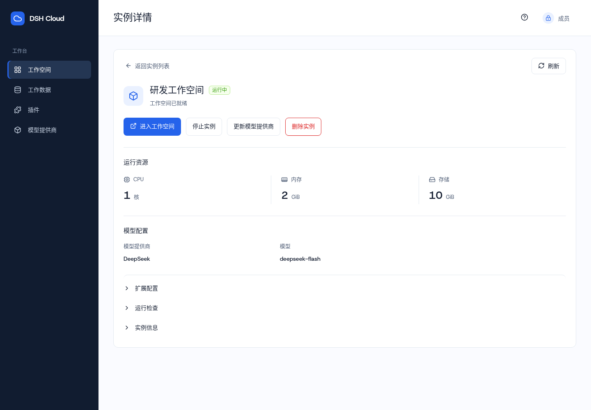
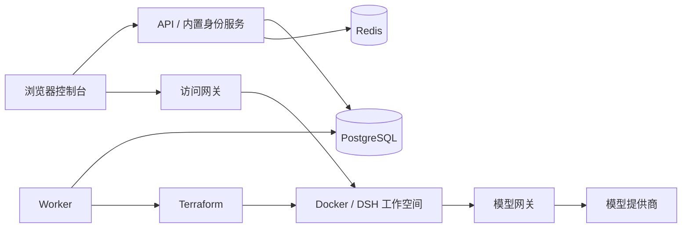

# DeepSeek Harness Cloud

**面向团队的 DeepSeek Harness 工作空间管理平台。**

通过浏览器创建和使用工作空间，统一管理模型接入、计算资源与持久数据，并在个人工作台维护技能、记忆、知识库和 MCP 连接器。

[](apps/package.json)
[](go.mod)
[](apps/package.json)

[功能特性](#功能特性) · [界面预览](#界面预览) · [快速开始](#本地开发) · [架构](#工程结构) · [文档](#文档入口) · [参与贡献](#参与贡献)

当前版本 **V0.1** 面向单组织、可信内部团队，采用 Docker 单机部署。已验证范围与待完成事项见[测试验收](docs/testing.md#11-当前验证范围与剩余工作)。

## 功能特性

| 能力 | 说明 |
| --- | --- |
| 工作空间生命周期 | 按需选择 CPU、内存、存储与模型提供商，支持创建、进入、启停和删除工作空间。 |
| 统一模型接入 | 管理个人提供商账号、密钥、可用模型与默认模型，通过 Go 模型网关接入官方或兼容服务。 |
| 持久工作数据 | 保留工作目录与 DSH 数据，浏览 `/data/workspace` 和 `/data/dsh`，支持文件、Office / PDF 预览及下载。 |
| 个人技能库 | 搜索主流技能来源，编辑、导入导出 Markdown / ZIP，并通过公开链接同步技能包。 |
| 记忆与知识库 | 在工作台维护、迁移和检索个人内容，外接 OpenViking / Mem0 / Graphiti 与 Milvus / Weaviate / Qdrant。 |
| MCP 连接器 | 内置分类目录，支持自定义 MCP、OAuth 授权、工具选择及手动调用，覆盖 GitHub、Context7 等开发工具。 |
| 原生扩展 | 启停内置插件、安装第三方 DSH 组合包、保存 Agent 预设。 |
| 团队管理 | 内置登录与账号管理、角色权限、实例 / CPU / 内存 / 存储额度和操作日志。 |

停止工作空间会释放计算资源；停止或软删除后仍保留数据并计入存储额度，可在“工作数据”中永久释放已删除工作空间的数据。详见[存储数据管理](docs/requirements.md#612-工作空间存储数据管理req-19)。

工作台中的技能、记忆、知识库和 MCP 操作，与 DSH 会话中的扩展配置分别管理。连接器需完成相应服务配置或授权，实网验证结果见[MCP 可用性记录](docs/connectors-reference.md#oauth-连接器可用性检查)。

### 技能来源

在工作台的“技能”页面点击“导入”，可搜索以下公开来源，查看技能文件后确认导入：

| 来源 | 导入方式 |
| --- | --- |
| [skills.sh](https://skills.sh/) | 搜索技能，从对应 GitHub 仓库预览并导入技能及资源文件。 |
| [ClawHub](https://clawhub.ai/) | 搜索公开技能并下载技能包；部分条目需要从其 GitHub 来源导入。 |
| [SkillHub](https://skillhub.cn/) | 搜索公开技能并通过 SkillHub 下载技能包。 |
| [SkillsMP](https://skillsmp.com/) | 搜索技能，使用结果提供的 GitHub 链接预览并导入。 |

也可使用公开链接或本地 Markdown / ZIP 文件导入。搜索结果由各来源提供，可能受到网络、权限或来源配额限制；搜索本身不会保存技能，导入前需预览并确认。详细行为与配置见[技能库说明](docs/frontend.md#个人技能包)和[来源出口配置](docs/deployment.md#技能包来源出口)。

## 界面预览

工作空间详情集中展示运行状态、资源与模型配置，常用生命周期操作可直接完成。以下截图使用演示数据。



## 本地开发

### 1. 准备环境

准备 Git、Make、Go **1.27.2**、Node.js **24.x**（含 npm）、Docker Engine 和 Docker Compose，并确保 Docker 服务已启动。

```bash
git clone https://github.com/jonluo94/deepseek-harness-cloud.git
cd deepseek-harness-cloud
npm ci --prefix apps
```

### 2. 初始化并启动 API

首次使用时，在仓库根目录执行：

```bash
make dev-init
make auth-init
make infra-up
make migrate
make auth-apply
make run-auth
```

这会启动 PostgreSQL、Redis、API 与内置身份服务。随机密码、密钥和本机配置保存在 Git 忽略的 `.local/` 中；初始化命令拒绝覆盖已有文件。已有环境再次启动时，执行 `make infra-up` 和 `make run-auth` 即可。

### 3. 启动控制台并登录

在另一终端的仓库根目录执行：

```bash
make portal
```

打开 **[控制台登录](https://127.0.0.1:42013/login)**，使用下列本地账号，密码从对应文件读取：

| 角色 | 账号 | 密码文件 |
| --- | --- | --- |
| 管理员 | `admin@harness.local` | `.local/auth/admin-password` |
| 成员 | `member@harness.local` | `.local/auth/member-password` |

API 默认地址为 `http://127.0.0.1:18080`，提供 `/livez` 和 `/readyz` 健康检查。依赖就绪后即可登录，无请求限流或启动冷却窗口。

### 4. 配置工作空间运行环境

完成以上步骤后即可访问控制台。要创建和进入 DSH 工作空间，还需按[部署运维指南](docs/deployment.md)配置运行镜像、Terraform 模板、持久存储、Worker、访问网关和模型网关。

启用实例访问入口后，通过 **[portal.harness.localhost:42013](https://portal.harness.localhost:42013/)** 访问控制台，并在本机信任 `.local/auth/cert.pem`，以访问实例的独立站点。

随后由管理员在“平台配置”设置默认资源和系统上限，成员在“模型提供商”添加账号并完成校验，即可创建工作空间。

### 常用命令

| 命令 | 用途 |
| --- | --- |
| `make portal` | 启动前端开发服务 |
| `make check` | 格式、静态检查与 TypeScript 类型检查 |
| `make test` | 运行单元测试与 Go 竞态检查 |
| `make build` | 构建后端与控制台 |
| `make ci` | 依次执行检查、测试与构建 |
| `make portal-preview` | 预览已构建的控制台，需先执行 `make build` |
| `make infra-stop` | 停止 PostgreSQL 与 Redis，保留数据卷 |

数据库集成测试、浏览器测试和真实运行验收见[测试验收](docs/testing.md)。

### 常见问题

<details>
<summary>浏览器提示证书不受信任</summary>

本地身份服务与控制台使用开发证书。将 `.local/auth/cert.pem` 加入本机信任，启用工作空间访问时使用 `portal.harness.localhost` 地址。证书与访问入口配置见[部署运维](docs/deployment.md)。

</details>

<details>
<summary>服务健康检查正常，但启动后暂时无法登录或创建实例</summary>

API / Gateway 不设置启动冷却窗口。持续失败时参照[部署运维](docs/deployment.md)检查依赖与日志。

</details>

## 工程结构

控制台使用 **React 19、TypeScript、Vite 和 Ant Design**；后端使用 **Go、PostgreSQL 和 Redis**。API、Worker、访问网关和模型网关分别运行，Worker 通过 Terraform 管理 Docker 工作空间。



```text
apps/             浏览器控制台与前端测试
services/         API、Worker、访问网关、模型网关及 hcctl 运维工具
infrastructure/   DSH 运行适配、Terraform 模板、存储与网络执行器
db/               数据结构与版本化迁移
api/              OpenAPI 接口规范
deploy/           本地依赖及可选服务部署配置
docs/             需求、架构、部署与验收文档
```

详细组件职责、请求流程与设计取舍见[系统设计](docs/design.md)和[架构决策](docs/decisions/README.md)。

## 文档入口

[文档总览](docs/README.md)提供完整阅读顺序，也可以按任务查阅：

| 我想…… | 阅读文档 |
| --- | --- |
| 了解产品能力与业务流程 | [功能需求](docs/requirements.md) |
| 部署、升级或排查问题 | [部署运维](docs/deployment.md) · [安全设计](docs/security.md) |
| 理解架构并参与开发 | [系统设计](docs/design.md) · [后端](docs/backend.md) · [前端](docs/frontend.md) |
| 对接 API 或了解数据结构 | [接口说明](docs/api.md) · [OpenAPI](api/openapi.yaml) · [数据设计](docs/data-model.md) |
| 运行测试、了解验收进度 | [测试验收](docs/testing.md) · [架构决策](docs/decisions/README.md) |
| 配置记忆与知识库服务 | [实施记录](docs/context-implementation.md) · [独立服务部署](deploy/context/README.md) |
| 接入 MCP 与 OAuth 服务 | [实施说明](docs/connectors-implementation.md) · [部署与复验](deploy/connectors/README.md) · [实网检查](docs/connectors-reference.md#oauth-连接器可用性检查) |

## 参与贡献

欢迎通过 [Issues](https://github.com/jonluo94/deepseek-harness-cloud/issues) 反馈问题或讨论功能，通过 [Pull Requests](https://github.com/jonluo94/deepseek-harness-cloud/pulls) 提交改进。

1. 对于较大的变更，先在 Issue 中说明使用场景与预期行为。
2. Fork 仓库并创建分支，完成改动及相关文档；修复缺陷时补充能够复现问题的测试。
3. 代码变更提交前运行 `make ci`，按涉及范围补充[集成或浏览器验证](docs/testing.md)。在 PR 中说明变更目的、行为变化和验证结果。

请勿提交 `.local/` 中的密码、密钥、令牌或本机配置。

## 许可证

原有代码采用 [MIT License](LICENSE)。

本项目基于 [DeepSeek Harness](https://github.com/deepseek-ai/deepseek-harness) 构建工作空间体验。
