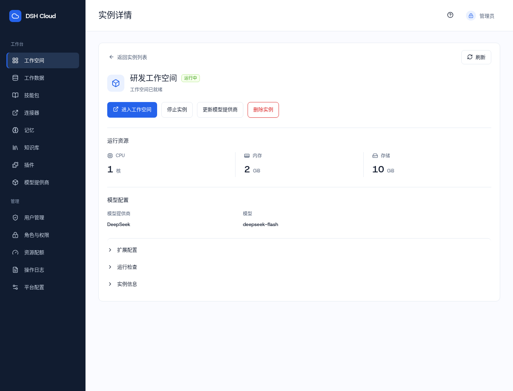
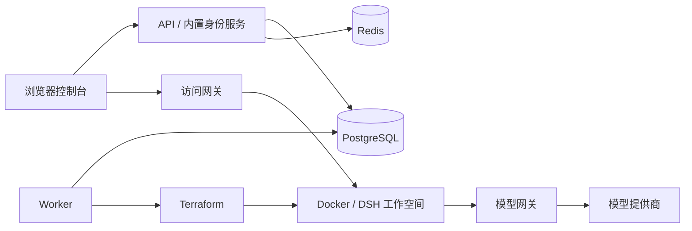

# DeepSeek Harness Cloud

**面向团队的 DeepSeek Harness 工作空间管理平台。**

通过浏览器创建和使用工作空间，统一管理模型接入、计算资源与持久数据，并在个人工作台维护技能、记忆、知识库和 MCP 连接器。

[](apps/package.json)
[](go.mod)
[](apps/package.json)

[功能特性](#功能特性) · [界面预览](#界面预览) · [快速开始](#本地开发) · [架构](#工程结构) · [文档](#文档入口) · [参与贡献](#参与贡献)

当前版本 **V0.2** 面向单组织、可信内部团队，采用 Docker 单机部署。已验证范围与待完成事项见[测试验收](docs/testing.md#11-当前验证范围与剩余工作)。

## 功能特性

| 能力             | 说明                                                                                                       |
| ---------------- | ---------------------------------------------------------------------------------------------------------- |
| 工作空间生命周期 | 按需选择 CPU、内存、存储与模型提供商，支持创建、进入、启停和删除工作空间。                                 |
| 统一模型接入     | 管理个人提供商账号、密钥、可用模型与默认模型，通过 Go 模型网关接入官方或兼容服务。                         |
| 持久工作数据     | 保留工作目录与 DSH 数据，浏览 `/data/workspace` 和 `/data/dsh`，支持文件、Office / PDF 预览及下载。        |
| 个人技能库       | 搜索主流技能来源，编辑、导入导出 Markdown / ZIP，并通过公开链接同步技能包。                                |
| 记忆与知识库     | 在工作台维护、迁移和检索个人内容，外接 OpenViking / Mem0 / Graphiti 与 Milvus / Weaviate / Qdrant。        |
| MCP 连接器       | 自定义 MCP 与 OAuth 接入，自动发现并启用新工具；新空间选择服务后可在 DSH 对话中调用，另提供手动试调用。    |
| 原生扩展         | 启停内置插件、安装第三方 DSH 组合包、保存 Agent 预设。                                                     |
| 插件库           | 浏览默认及个人插件目录，在线/离线添加、编辑个人资料并下载原包；提供本项目维护的 Mem0 / Graphiti 记忆插件。 |
| 团队管理         | 内置登录与账号管理、角色权限、实例 / CPU / 内存 / 存储额度和操作日志。                                     |

停止工作空间会释放计算资源；停止或软删除后仍保留数据并计入存储额度，可在“工作数据”中永久释放已删除工作空间的数据。详见[存储数据管理](docs/requirements.md#612-工作空间存储数据管理req-19)。

工作台管理与创建时的扩展选择分别操作；创建可选技能、连接器、记忆、知识库及兼容插件，运行接入按当前权限验证。连接器需完成相应服务配置或授权，实网验证结果见[连接器实网验证边界](deploy/connectors/README.md#实网验证边界)。

创建工作空间时选择 Mem0 或 Graphiti 记忆连接并开启“完整会话同步”，平台会安装并启用对应原生插件。两者先保存原始会话，归档后提取长期记忆用于管理和召回；已有工作空间的 Profile 不自动升级。Mem0 另支持独立安装，独立模式默认关闭自动采集，与平台连接分别配置。详见[插件分发总览](infrastructure/plugins/README.md)、[Mem0](infrastructure/plugins/mem0/README.md)、[Graphiti](infrastructure/plugins/graphiti/README.md)及[插件库规则](docs/requirements.md#618-插件req-24)。

### 在 DSH 中使用 MCP

1. 在“连接器”添加自定义 MCP，填写 Streamable HTTP 地址与认证信息。保存启用的服务后自动发现工具；OAuth 服务先完成授权。新工具默认启用，可按需关闭。
2. 新建工作空间，在扩展的“连接器”中选择该服务，进入 DSH 后直接要求调用，例如：`调用“我的测试 MCP”的 echo 工具，text 填写“你好 MCP”，收到结果后返回原文。`
3. 已绑定的新空间自动跟随服务启停和工具目录变化；停用服务保留配置，重新启用后恢复连接。

旧空间的 Profile 保留，使用新的逐工具调用方式需新建空间并选择连接器。平台复用 DSH 官方 MCP 适配器，DSH 本体与运行镜像保持不变。完整步骤见[连接器使用说明](deploy/connectors/README.md#在-dsh-对话中调用)；已完成[新空间真实模型调用验证](docs/testing.md#新空间真实mcp对话2026-11-10)，验收范围为合成服务的 `echo`。

### 技能来源

在工作台的“技能”页面点击“导入”，可搜索以下公开来源，查看技能文件后确认导入：

| 来源                              | 导入方式                                                     |
| --------------------------------- | ------------------------------------------------------------ |
| [skills.sh](https://skills.sh/)   | 搜索技能，从对应 GitHub 仓库预览并导入技能及资源文件。       |
| [ClawHub](https://clawhub.ai/)    | 搜索公开技能并下载技能包；部分条目需要从其 GitHub 来源导入。 |
| [SkillHub](https://skillhub.cn/)  | 搜索公开技能并通过 SkillHub 下载技能包。                     |
| [SkillsMP](https://skillsmp.com/) | 搜索技能，使用结果提供的 GitHub 链接预览并导入。             |

也可使用公开链接或本地 Markdown / ZIP 文件导入。搜索结果由各来源提供，可能受到网络、权限或来源配额限制；搜索本身不会保存技能，导入前需预览并确认。详细行为与配置见[技能库说明](docs/frontend.md#个人技能包)和[来源出口配置](docs/deployment.md#技能包来源出口)。

## 界面预览

管理员视角的工作空间详情展示运行状态、资源与模型配置，侧栏包含工作台和管理入口。截图使用管理员权限的演示数据。



## 本地开发

### 1. 准备环境

准备 Git、Make、Go **1.27.2**、Node.js **24.x**（含 npm）、Python **3.11+**、Docker Engine 和 Docker Compose，并确保 Docker 服务已启动。

```bash
git clone https://github.com/jonluo94/deepseek-harness-cloud.git
cd deepseek-harness-cloud
npm ci --prefix apps
```

### 2. 初始化并启动 API

首次使用时，在仓库根目录执行：

```bash
make dev-init
make auth-init
make infra-up
make migrate
make auth-apply
make run-auth
```

`make infra-up` 启动 PostgreSQL 和 Redis；`make migrate` 执行数据库迁移并更新受限角色授权，`make auth-apply` 导入初始账号。`make run-auth` 在前台运行 API（包含内置身份服务），该终端需保持运行。随机密码、密钥和本机配置保存在 Git 忽略的 `.local/` 中。已有环境再次启动时，执行 `make infra-up` 和 `make run-auth`；后者也会执行迁移、授权更新及本地数据初始化。

### 3. 启动控制台并登录

在另一终端的仓库根目录执行：

```bash
make portal
```

打开 **[控制台登录](https://127.0.0.1:42013/login)**，使用下列本地账号，密码从对应文件读取：

| 角色   | 账号                   | 密码文件                      |
| ------ | ---------------------- | ----------------------------- |
| 管理员 | `admin@harness.local`  | `.local/auth/admin-password`  |
| 成员   | `member@harness.local` | `.local/auth/member-password` |

API 默认地址为 `http://127.0.0.1:18080`，提供 `/livez` 和 `/readyz` 健康检查。以上步骤启动控制台所需的基础服务；Worker、访问网关和模型网关需另行配置与启动。

### 4. 配置工作空间运行环境

完成以上步骤后即可访问控制台。要创建和进入 DSH 工作空间，还需按[部署运维指南](docs/deployment.md)配置运行镜像、Terraform 模板、持久存储、Worker、访问网关和模型网关。

配置域名访问入口后，重启 API 与控制台，启动访问网关，通过 **[portal.harness.localhost:42013](https://portal.harness.localhost:42013/)** 访问控制台。浏览器所在机器需信任 `.local/auth/cert.pem` 开发 CA，以访问工作空间的独立站点。

随后由管理员在“平台配置”设置默认资源和系统上限，成员在“模型提供商”添加账号并完成校验，即可创建工作空间。

### 可选：通过局域网 IP 访问

完成域名访问配置后，可增加 IP 入口。将下面的示例 IP 替换为部署主机实际可监听的局域网 IP，在仓库根目录执行：

```bash
HC_PUBLIC_IP=192.168.1.100 make ip-access-init
```

重启 API 和访问网关后，通过 `https://192.168.1.100:42013` 访问控制台；工作空间使用同一入口下的 `/dsh/<实例UUID>/` 路径，静态资源和 WebSocket 也经此入口转发。客户端需信任开发 CA，并能连接该 HTTPS 端口；使用浏览器系统代理时将此 IP 设为直连。端口可通过 `HC_IP_PORTAL_PORT` 调整，OAuth 回调也需登记相应的 IP 入口地址，详见[部署运维](docs/deployment.md)。

### 常用命令

| 命令                  | 用途                                      |
| --------------------- | ----------------------------------------- |
| `make portal`         | 启动前端开发服务                          |
| `make test`           | 运行单元测试与 Go 竞态检查                |
| `make build`          | 构建后端与控制台                          |
| `make portal-preview` | 预览已构建的控制台，需先执行 `make build` |
| `make infra-stop`     | 停止 PostgreSQL 与 Redis，保留数据卷      |

数据库集成测试、浏览器测试和真实运行验收见[测试验收](docs/testing.md)。

### 开发检查

在仓库根目录安装运行适配与插件测试所需的固定 DSH 依赖，再执行检查：

```bash
npm ci --prefix infrastructure/runtime
GOMODCACHE=/tmp/hc-go-mod GOCACHE=/tmp/hc-go-build go vet ./...
npm run typecheck --prefix apps
make test
make build
```

`make test` 包含 Python、Go（含竞态检查）、前端、Node 及原生插件测试；缺少外部环境的测试会按条件跳过，完整集成验收需另行执行。

当前格式检查脚本仍引用仓库中已缺失的 Prettier 配置，`make format`、`make format-check`、`make check` 和 `make ci` 尚不能作为完整可用的检查入口。现状与复验方式见[工程检查现状](docs/testing.md#工程检查现状)。

### 常见问题

<details>
<summary>浏览器提示证书不受信任</summary>

本地控制台和工作空间入口使用开发证书。将部署主机上的 `.local/auth/cert.pem` 开发 CA 加入浏览器所在机器的信任库，使用已配置的域名或 IP 入口访问。只接受一次证书警告可能仍导致工作空间连接失败；证书与访问入口配置见[部署运维](docs/deployment.md)。

</details>

<details>
<summary>服务健康检查正常，但启动后暂时无法登录或创建实例</summary>

API / Gateway 不设置启动冷却窗口。持续失败时参照[部署运维](docs/deployment.md)检查依赖与日志。

</details>

## 工程结构

控制台使用 **React 19、TypeScript、Vite 和 Ant Design**；后端使用 **Go、PostgreSQL 和 Redis**。API、Worker、访问网关和模型网关分别运行，Worker 通过 Terraform 管理 Docker 工作空间。



```text
apps/             浏览器控制台与前端测试
services/         API、Worker、访问网关、模型网关及 hcctl 运维工具
infrastructure/   DSH 运行适配、Terraform 模板、存储与网络执行器
db/               数据结构与版本化迁移
api/              OpenAPI 接口规范
deploy/           本地依赖及可选服务部署配置
docs/             需求、架构、部署与验收文档
```

详细组件职责、请求流程与设计取舍见[系统设计](docs/design.md)和[后端架构](docs/backend.md)。

## 文档入口

[文档总览](docs/README.md)提供完整阅读顺序，也可以按任务查阅：

| 我想……                  | 阅读文档                                                                                                                                             |
| ----------------------- | ---------------------------------------------------------------------------------------------------------------------------------------------------- |
| 了解产品能力与业务流程  | [功能需求](docs/requirements.md)                                                                                                                     |
| 部署、升级或排查问题    | [部署运维](docs/deployment.md) · [安全设计](docs/security.md)                                                                                        |
| 理解架构并参与开发      | [系统设计](docs/design.md) · [后端](docs/backend.md) · [前端](docs/frontend.md)                                                                      |
| 对接 API 或了解数据结构 | [接口说明](docs/api.md) · [OpenAPI](api/openapi.yaml) · [数据设计](docs/data-model.md)                                                               |
| 运行测试、了解验收进度  | [测试验收](docs/testing.md) · [Graphiti DSH 专项](docs/testing-graphiti-dsh.md)                                                                      |
| 配置记忆与知识库服务    | [独立服务部署](deploy/context/README.md)                                                                                                             |
| 接入 MCP 与 OAuth 服务  | [部署与复验](deploy/connectors/README.md)                                                                                                            |
| 安装或维护原生记忆插件  | [分发总览](infrastructure/plugins/README.md) · [Mem0](infrastructure/plugins/mem0/README.md) · [Graphiti](infrastructure/plugins/graphiti/README.md) |

## 参与贡献

欢迎通过 [Issues](https://github.com/jonluo94/deepseek-harness-cloud/issues) 反馈问题或讨论功能，通过 [Pull Requests](https://github.com/jonluo94/deepseek-harness-cloud/pulls) 提交改进。

1. 对于较大的变更，先在 Issue 中说明使用场景与预期行为。
2. Fork 仓库并创建分支，完成改动及相关文档；修复缺陷时补充能够复现问题的测试。
3. 按[开发检查](#开发检查)准备工具，提交前执行其中的静态检查、测试与构建，按涉及范围补充[集成或浏览器验证](docs/testing.md)。在 PR 中说明变更目的、行为变化和验证结果。

请勿提交 `.local/` 中的密码、密钥、令牌或本机配置。

## 许可证

原有代码采用 [MIT License](LICENSE)。

本项目基于 [DeepSeek Harness](https://github.com/deepseek-ai/deepseek-harness) 构建工作空间体验。
