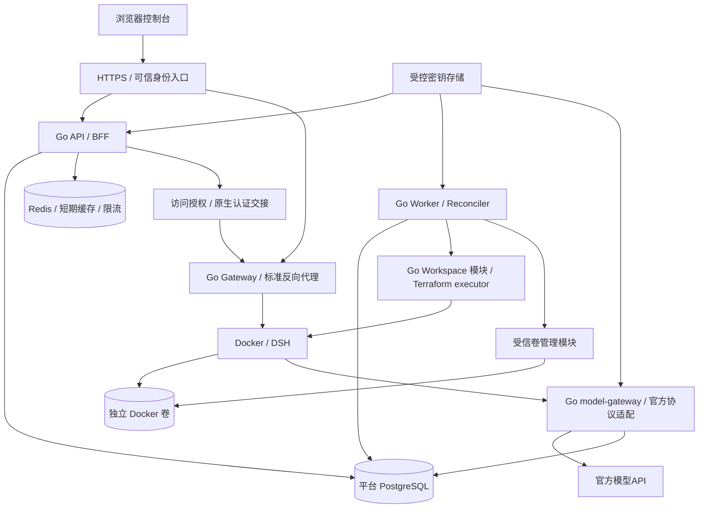

# DSH Cloud 后端技术架构

版本：V0.1。Go API/Worker/Gateway、身份、配置、生命周期、内嵌 Workspace、原卷与受控访问已有实现。本机运行闭环及部分运维能力已验证；当前验收状态与未完成范围集中见[测试验收](testing.md)，需求见[功能需求](requirements.md)，选择理由见[ADR](decisions/README.md)。

## 1 架构目标

后端技术栈确定为 **Go + Redis + PostgreSQL**，配套技术与版本策略见[技术选型](#2-技术选型)。以单组织、Docker、固定模板和一个默认模型完成一键创建并真实运行。业务规则集中在后端：可信身份、Owner、配置版本、资源额度、状态转换、删除保护和访问撤销。浏览器、异步任务及外部响应均不能绕过这些规则。

采用一个 Go 工程的模块化结构。API、受信Worker、工作空间访问Gateway及原生模型Gateway使用同一Go工程，以四个进程和不同受限身份运行；PostgreSQL、Redis和必要的受控入口为基础依赖，Workspace/模板/构建在 Go 内部模块实现。Storage是Worker内部职责，Gateway是同工程访问入口，不引入独立微服务工程或消息队列。

## 2 技术选型

| 技术 | 开发基线 | 职责与约束 |
| --- | --- | --- |
| Go | 1.27.2，见 go.mod 的 toolchain | 标准net/http API/BFF、领域对象、Worker与Gateway；HTTP超时/取消/优雅退出；同工程分权限运行，框架按实际需要引入 |
| PostgreSQL | 17 | 业务事实、事务/约束、Outbox、配额、会话和审计 |
| Redis | 7.4 | 脱敏短期缓存与原子限流；ACL/noeviction；不能保存唯一授权/任务 |
| pgx | v5 | 显式SQL、事务、条件更新、索引/约束和连接池；避免隐式事务，结构见[db/schema.sql](../db/schema.sql) |
| go-redis | v9 | Cache/RateLimiter端口适配，200ms有界超时 |
| OIDC / OAuth2 | 平台 AuthorizationServer + go-oidc/oauth2/go-jose + bcrypt | 内置授权码/PKCE、RS256/JWKS、数据库账号与BFF；标准库和成熟签名/散列实现 |
| crypto/aes、cipher.GCM | Go标准库 | AES-256-GCM、外置主密钥、AAD、key_id |
| 内嵌 Workspace 模块 + Terraform Provider | 上游源码 v2.37.4，Terraform 1.15.5，Coder Provider 2.19.0，Docker Provider 4.6.0 | Go 内部编排Workspace/TemplateVersion/Build，平台PG持久化，Worker执行受控Terraform |
| Docker Engine | D0按目标主机锁定兼容版本 | 固定DSH镜像digest、非特权用户、批准规格、容器硬限额及独立卷、隔离网络；成员无Socket |
| net/http/httputil | Go标准库 | 最小Gateway、固定路由、HTTP/WS代理、实时授权 |
| OpenAPI | 3.0.3 | 平台API契约、类型生成与fixture验证 |
| 异步任务 | PostgreSQL Operation/Outbox + Worker | 有界领取、幂等、租约和对账，不新增消息队列 |
| 秘密 | 受控密钥存储及版本引用 | AES-256-GCM密文存PG，key_id/AAD；主密钥只读文件外置 |
| 观测 | 结构化日志、指标、关联 ID | 脱敏；不记录 Key/Token/工作正文 |

精确 Go/驱动版本锁定在 go.mod/go.sum，本地 PG/Redis 镜像 digest 在 deploy/local/compose.yaml。运行命令见 README；运行批准绑定实际模板、镜像、helper 和协议摘要。升级需运行相应契约与回归测试。

OIDC验证库和oauth2库锁精确版本；Workspace/模板/构建与Terraform执行子集的复用边界见[ADR-01](decisions/0001-coder-integration.md)。Redis可重建，失效策略见[PostgreSQL与Redis分工](#71-postgresql-与-redis-分工)。

平台物理SQL与初始迁移已在PostgreSQL 17验证空库、并发/重复应用及结构约束。DSH/Coder源码/Provider精确版本、私有凭据通道和 Worker 外部执行已通过本地真实契约；Gateway 已通过真实 Portal/DSH 浏览器交接，命令接口已接入真实运行预检；模板完整批准与首次配置/创建/进入已有真实证据；普通浏览器模型文件任务和重启文件校验也已有独立产品证据。

官方依据：[Go发行](https://go.dev/dl/)、[PostgreSQL支持策略](https://www.postgresql.org/support/versioning/)。选定版本是本项目兼容性基线，不是对“最新版”的声明。

## 3 运行拓扑与权限



API 进程不挂 Docker Socket。需要主机管理能力的 Provisioner/存储执行器属于受信 Worker 边界，运行身份、网络及挂载最小化。成员容器不能访问管理 Socket、平台数据库、主机密钥或其他用户卷。

工作空间、模板版本和构建记录使用平台 PostgreSQL 的 workspace_* 表，源代码抽取范围和迁移见 ADR-01。平台管理权限不等同于受信 Worker/主机特权运维权限。访问方案无论复用还是自定义，都须封闭直连及端口共享旁路。

## 4 模块划分

API-043的25项权限名称、用途说明和依赖由`identity/permissions.go`统一维护，与数据库权限目录核对；目录说明不修改角色授权。数据查看、预览下载沿用instances:read，永久释放存储使用instances:release-storage；前端按业务分组，提交仍仅使用原权限ID。

REQ-13～15由 identity 管理应用服务、受控 IAM 数据库函数与有效权限目录实现。最后管理员、内置/在用角色、不可变主体和Owner由事务约束保护，变更与会话撤销、代次递增和审计原子提交；内置 Accounts 在意图提交后写入平台数据库，结果未知继续原任务。

| 当前包 | 职责 | 主要边界 |
| --- | --- | --- |
| `identity` | OIDC、会话、固定组织、角色、Owner 映射与撤销 | Principal 来自服务端；事务内重新授权 |
| `settings` | 模型保存/校验/撤销、默认项、模板和预检 | 版本、加密、Probe 租约与持久预算 |
| `instances` | 查询、命令、重试、状态规划、幂等、配额及资源审计查询 | 接受短事务；不执行 Docker/Terraform |
| `worker` | Outbox/租约、检查点/构建意图、原卷/配置/网络、终态、健康与安全停止 | 唯一正常外部执行边界；最小受信主机权限 |
| `workspace` | Workspace/TemplateVersion/Build 持久化、稳定名称、Terraform 排他执行 | 固定 authority、模板不可变、连续 Build、私有 state |
| `access` | 挑战/票据/会话、Owner、原生认证和 HTTP/WS 代理 | 精确 Host/Origin、每次请求再授权、无任意上游 |
| `admission` / `hostcapacity` | Worker/HTTPS/运行批准观察、主机容量准入 | 预检不代替接受事务内的配额及授权校验 |
| `runtimeapproval` | 固定模板/镜像/helper 契约验证、受信批准、兼容升级/回滚 | 普通服务没有批准写权 |
| `operations` | 数据库/卷备份恢复、回收、资源核对/保留/接纳、来源围栏、密钥维护与审计归档 | 受信 CLI；维护意图与隔离恢复 |
| `retention` | 已到期短期记录有界清理 | 保护活跃操作/会话/FK 引用 |
| `security` / `pagination` / `ratelimit` | 密文与密钥环、签名游标、Redis 限流/重连冷却 | 有界依赖；不保存唯一授权/配额事实于 Redis |
| `httpserver` / `webapi` / `bootstrap` / `config` / `devlocal` | 协议、严格输入、进程装配、私有配置、本地环境和角色授权 | 组合具体服务；开发初始化不进入正常浏览器路径 |

生命周期操作及配额属于 `instances`/`worker`，`operations` 包专指受信运维；不存在独立的 configuration/quotas/storage/audit 服务包。规则、用例、SQL 和外部集成按文件职责组织，确有复用时再提取包。

## 5 工程目录

```text
services/
  cmd/api/                  API / BFF 进程入口
  cmd/worker/               常驻任务、构建与健康进程入口
  cmd/gateway/              工作台 HTTP/WS 进程入口
  cmd/hcctl/                迁移、初始化、运行批准及受信运维命令
  internal/                 上表所列实际模块
db/
  migrate.go                迁移序列、校验和和 schema 就绪检查
  migrations/               不可变有序迁移
  schema.sql                迁移链汇总，不用于覆盖已运行数据库
infrastructure/
  terraform/                固定模板、Provider lock、本机执行工具
  runtime/                  固定 DSH、私有启动适配与契约测试
  storage/                  独立硬容量存储 helper
  network/                  受控网络 helper
  local/                    本机备份定时器安装
deploy/local/               PostgreSQL/Redis Compose 与备份服务模板
```

API、Worker、工作空间访问Gateway由 `bootstrap.Run` 装配；原生模型Gateway由独立 `cmd/model-gateway` 装配。同一工程按职责使用不同运行身份。源码目录只放实现/固定输入/测试；本机凭据、二进制、运行记录及 Terraform state 放受控私有目录，生成的 node_modules/dist/tsbuildinfo 不入源码。真实集成测试使用明确边界，不以 Mock 替代 Workspace/Terraform/Docker 验收。

## 6 请求与事务流程

### 6.1 一键创建

1. HTTP 中间件验证身份，服务端确定固定组织和真实 Owner。
2. 校验请求及 Idempotency-Key；已有同键请求返回首次快照和原操作。
3. 读取一致的批准默认项、模板和有效模型版本，生成不可变实例 ID 及稳定外部创建标识。
4. 单事务校验并预留资源，写实例、幂等记录、Operation、Outbox 与审计；竞争由数据库约束处理。
5. 提交后返回 202 和 instance_id/operation_id，Worker 执行准备卷、Workspace Build、配置和检查。
6. 查询接口返回实际状态、阶段及五维健康。首次必需检查失败记录 FAILED 和已存在资源。

外部调用放在数据库事务之外。提交失败不登记 Workspace 构建或执行 Terraform；外部成功但回写失败，使用稳定标识定位原资源并恢复关联。默认项更新不改变同键重放结果。

### 6.2 启停、删除和配置

统一进入 instances/operations 用例，重新鉴权并检查单活跃操作。停止先撤销入口再确认计算释放；启动核验原卷；软删除确认名称并保留卷。配置应用明确指定模型版本及实例版本，失败回退检查凭据仍有效。

永久卷回收属于受控运维流程，用户 API 不接受任意卷名或永久删除参数。受影响实例及操作必须保留审计关联。

## 7 异步执行与故障恢复

任务采用至少一次处理。Worker 有限批量领取，使用数据库行锁/条件更新及租约 token；每次阶段回写检查操作/实例版本与当前租约。SQL索引/约束见 [schema.sql](../db/schema.sql)，锁序和条件回写见 [数据设计](data-model.md)，60秒租约/15秒续租等参数见配置。

ACCEPTED/RUNNING/UNCERTAIN 都占活跃操作槽。无活跃操作且无冲突存储维护的 ERROR 实例允许接受 DELETE；此转换仅排队清理，不推断计算已消失。Worker 仍需核验 Workspace/Build/宿主机资源并确认移除，才能发布 DELETED 和释放计算、实例额度；保留原卷。UNCERTAIN 保留未确认额度，查询外部 Workspace/Build/卷后再进入终态或继续执行。只有经对账且允许重试的 FAILED 才接受重试命令。

数据库 fencing 只防止旧执行器回写，不能撤销已发出的外部请求。相同实例始终使用同一外部创建标识；必须验证外部唯一性、迟到成功与冲突语义。无法确认时不改名重建，不释放未确认额度。

已实现的 Workspace Build 写入先持久化 `external_build`：原 Build ID/序号、固定模板版本、目标 transition、阶段、已确认的 Build ID 及完成标志。新尝试只发送一次；恢复只接管符合原序号+1、固定模板、Owner/控制发起者及参数的构建。无法判断请求是否发出时保持 UNCERTAIN，不盲目重发。CONFIGURE 的 STOP 确认完成后才写 START 意图。运行代次采用本次操作 UUID，已发布原生 Cookie 加密且绑定该代次。

常驻 Runner 最多 2 个用户任务和 1 个 SYSTEM STOP；60 秒租约、15 秒续租、未知结果延后 10 秒。失租取消后续动作；退出停止领取，最多等待 20 秒，随后取消执行并最多等待 10 秒。主机使用同实例 flock，存储/网络 helper 带实例标签；新租约发现遗留运行 helper 时拒绝并发修改。确定失败先撤销访问、停止已验证的本实例计算，确认不存在后才释放计算额度；数据资产保留。

重试采用有界退避，区分确定拒绝、可重试故障和结果未知。Worker 退出停止领取、处理续租与未完成记录；重启先对账。详见 [ADR-06](decisions/0006-outbox-reconciliation.md)。

### 7.1 PostgreSQL 与 Redis 分工

PostgreSQL 是实例、配置版本、幂等记录、Operation/Outbox、配额、审计和认证代次的权威存储。Redis 保存可丢弃的短期脱敏缓存和有界请求限流计数，不承担唯一操作队列、资源预留或分布式锁正确性。自定义一次性票据仍按数据库原子消费方案实现。

缓存采用 cache-aside，Key 包含环境/组织/主体或资源/配置版本，带有限 TTL。查询命中缓存前仍校验当前主体、组织和资源权限，不返回已失权用户的数据。写操作提交 PostgreSQL 后失效相关缓存，删除失败依靠 TTL 收敛；安全命令始终读取 PostgreSQL 当前权限、版本和资源状态，不按缓存批准。健康保留原 checked_at/expires_at，缓存命中不得延长有效期。

Redis 限流按主体/动作原子更新，计数与过期在同一原子操作内完成。模型费用预算和实例额度仍持久化控制，Redis 重启不能放宽持久预算。Redis 只用于提速和短期流量控制，窗口、TTL和容量按 [配置基线](deployment.md#8-配置与业务规则基线) 实现并测试。

| Redis 状况 | 后端行为 |
| --- | --- |
| 缓存未命中/不可用 | 有界回源 PostgreSQL，避免无限重试或集中打满连接池 |
| 创建/模型探测限流不可确认 | 拒绝新请求并返回脱敏依赖不可用，预检禁止创建 |
| 新的访问交接限流不可确认 | 拒绝交接，不能使用缓存旧许可放行 |
| 权限撤销/停止/删除 | 不依赖缓存成功；走数据库授权、单操作约束和审计，持续执行安全清理 |
| 已接受的持久操作 | Worker 从 PostgreSQL 继续执行/对账，不因缓存丢失重复创建 |

Redis 放内部网络，使用 ACL 和最小命令/键权限，禁止浏览器及成员容器直连。配置内存上限、TTL 和明确淘汰策略；同一实例承载限流计数时采用 noeviction 并严格限制缓存容量，写入失败按限流不可确认处理。Redis 不备份为业务事实，重启由数据库安全重建缓存。

## 8 配置、健康与访问

模型验证与实例健康检查分别绑定具体版本和资源。读列表/详情只读已有健康结果，不能每次触发计费模型探测；探测由有界任务执行，过期按 UNKNOWN。

ready 由 RUNNING 和五维健康计算；can_enter 同时依赖当前主体授权和必需健康。它们不是持久化的通用授权。进入请求实时检查 Owner、路由和认证代次；代理需持续执行撤销。

平台交接协议已固定，原生凭据通道及Cookie适配按D0做固定版本契约测试；实现依据见 [ADR-05](decisions/0005-native-auth.md) 和 [ADR-07](decisions/0007-access-gateway.md)。普通浏览器只调用平台 API，不取得控制面凭据或 Docker 地址。

## 9 API 与观测规范

使用 [OpenAPI](../api/openapi.yaml) 的路径、错误包和 API 编号。写入严格校验字段、长度、版本与白名单；禁止任意 endpoint/镜像/Owner/挂载。Cookie/CSRF、分页、幂等和错误以OpenAPI及安全文档为准。

外部 HTTP 调用配置连接/响应超时、响应体上限及取消；模型请求限制协议、目标、合成内容、输出与费用。日志、审计、诊断和错误不回显秘密或内部堆栈。

传播 request_id、trace_id、operation_id、instance_id；监控操作耗时/失败、Outbox 积压、租约、健康、撤销、配额和磁盘。资源 ID 作为日志字段，避免无界指标标签。

## 10 实施与验收

开发依赖统一见[功能需求](requirements.md#9-实施顺序)，REQ→当前对象/API/数据/TC 统一见[测试追踪](testing.md#3-需求追踪)。新增行为按 TDD 先规则/用例失败测试，再实现及重构；涉及事务、权限或外部效果时同步运行真实边界测试。API 命令、Gateway 和真实一键运行已接通，剩余恢复切换及完整运维/安全/性能范围以测试状态为准。

## 11 面向对象实现约束

具体对象、方法和依赖关系见[系统对象设计](design.md#8-面向对象详细设计)。HTTP handler 组合应用服务；服务使用显式 pgx 事务及使用方接口；Worker 的 `Runner` 注入 `WorkQueue`/`LeaseExecutor`，`Executor` 注入 `WorkspaceControl` 和具体主机适配。访问服务注入 `Ownership`/`NativeVerifier`，模型服务使用 `Probe`/`RuntimeChecks`。错误在 HTTP 边界映射，纯规则对象不返回 HTTP 状态码。

依赖由 bootstrap 和构造函数装配，不使用服务定位器、继承层级或通用 CRUD 框架。数据库事务不跨 Docker/Terraform/模型网络请求；代次、稳定意图和重新核验连接事务与外部效果。Redis 仅提供限流及可重建状态，不能进入生命周期规划作为权威。

API 只能提交意图，Gateway 读取授权并受限写访问会话，Worker 具备必要主机能力；受信 CLI 才能迁移、批准模板、恢复和回收。API/Gateway 无 Terraform state 读取权，Worker 无模板发布/批准写权，细节见[数据库角色](data-model.md#9-保留清理与数据库权限)。

## 12 运行适配与外部契约

平台契约已定义；上游精确版本和真实运行兼容性由 D0 契约测试锁定。infrastructure/runtime已提供锁定0.2.1-alpha.2发布包的镜像与启动适配，真实容器已验证私有凭据通道、自动目录/模型、HTTP/WS认证、重启换代、独立硬容量原卷和网络围栏；真实Workspace模板启停/销毁保卷已验证，平台 Gateway 的真实浏览器 HTTP/WS 访问已验证。

### 12.1 上游与适配范围

DSH 上游为 [deepseek-ai/deepseek-harness](https://github.com/deepseek-ai/deepseek-harness)。当前官方文档说明 Web 采用根路径 Token/Cookie 交换、Host/Origin 校验，默认端口 3080，`--host` 不支持通配绑定。工程必须把源码审查 commit、发布包版本/npm完整性锁、镜像 sha256、Coder/Provider/模板版本分别写入运行 manifest；审查commit不是发布包构建来源证明，不得混用。禁止运行时下载最新版。 创建/启动接受前由 API 的 admission 模块核验真实 Workspace Owner、受控 Worker 的镜像/容量事实、Gateway 就绪和实例域 HTTPS；所有网络观察均在数据库行锁之外，总预算5秒、单个 HTTP 请求最多3秒、禁止代理/重定向、响应最多8KiB。实例域以无凭据的固定探测 UUID 请求根路径，必须收到 Gateway 的401；本地 `.localhost` 仅在 local/test 映射回环，仍验证证书与主机名。

采用平台维护的受限启动适配包与原生 Web 基础profile，保留 DSH 原生认证。Owner可在持久profile中管理可选组合包与预设设置，平台启动覆盖层固定模型路由、认证及运行边界。适配包负责配置生成、工作目录初始化、结构化就绪和原生会话建立；不重新实现 DSH 对话/工具引擎。所有上游专有字段和 RPC 只出现在该适配包，前端/领域层不能引用。

### 12.2 启动与配置契约

| 输入 | 规则 |
| --- | --- |
| 身份 | instance/org/owner UUID 与 storage asset UUID，不能从工作文件推导 |
| 路径 | 一个数据资产挂载 `/data`；工作目录 `/data/workspace`，DSH_HOME=`/data/dsh` |
| 配置 | manifest 固定基础profile及启动覆盖策略；Owner管理可选插件和预设设置，模型路由、默认模型覆盖与权限策略仍由平台控制 |
| Web | 端口 3080；绑定容器单个内网 IP；public URL 为实例 HTTPS 根；trusted-host 仅实例精确域名 |
| 模型 | 当前 `deepseek-official` / `deepseek-messages`，批准 endpoint 与模型；Key 单独受控注入；平台模型网关适配见12.7节 |
| 启动输出 | 仅版本、instance_id、config_version、非敏感 health；禁止打印 Token 链接 |

启动器生成 profile patch 与必要设置时使用 YAML/JSON 结构化序列化、临时文件+fsync+原子 rename、0600/0700 权限；不使用字符串拼接 Shell。模型 Key 不放 Terraform 参数/state、镜像层、普通日志；由受信执行器在受控临时文件或进程环境提供，进程启动后清除临时副本。直接注入限制见安全文档。

适配包在未开放入口前，完成工作目录注册与默认工作空间选择、默认模型选择，且不创建用户任务。验收必须证明新浏览器打开即有选定工作目录和模型。若锁定上游只能通过其 RPC 设置，则由受信适配包调用相应已验证方法；具体 RPC 名称由固定版本契约测试记录，不在平台公开 API 发明通用 `/configure` 接口。

运行 manifest 包含 `schema_version,upstream_commit,image_digest,storage_image_digest,network_image_digest,workspace_source_version,terraform_version,terraform_provider_lock,template_version,profile_digest,config_format,workspace_bootstrap_adapter,native_auth_adapter,persistent_paths,tool_policy_digest,runtime_package_version,runtime_package_integrity,runtime_adapter_digest`。D0 输出实际值和请求 fixture 后才允许真实创建，不把 master 分支 URL 当版本锁。 首版 manifest 使用 `schema_version=1`；三个 digest 字段及 Provider lock 均为完整 sha256，`workspace_source_version` 表示锁定的 Coder 源码版本（非独立服务版本），与源码锁相同，`template_version` 必须等于批准行。`config_format=hc-runtime-config-v1`、`workspace_bootstrap_adapter=harness-cloud-bootstrap-v1`、`native_auth_adapter=dsh-root-token-cookie-v1`，持久路径固定为 `/data/workspace` 和 `/data/dsh`。API 拒绝空 manifest、缺字段、未知字段、未知适配器或实际 Worker 镜像不一致；这些结构检查不代替 D0 的真实证据和受控批准。

### 12.3 原生认证与访问路径

平台采用 Go 访问模块和标准反向代理转发，DSH 原生 Cookie 仅在服务端持有。内嵌 Workspace 模块只承担编排与 Owner 元数据核对，不作为首版浏览器工作台入口；避免同时维护两种入口。具体浏览器挑战/票据协议见 [安全设计](security.md)。

上游明确：`GET /?token=...` 换签名 Cookie并重定向干净根路径；其他路径不接受 query Token，也不接受 Authorization Token。启动 Token 如何在内存取得、Cookie 名称/属性由锁定版本适配，不能解析普通 stdout 日志。启动适配包在 Web 初始化时通过受支持服务/受限插件取得原生启动凭据，并经仅可信执行器可读的通道交给服务端；确实需要源码适配时只修改这层，不关闭认证。D0 先证实这个通道再构建镜像。

服务端交换用固定实例 Host、上游地址和 `GET /?token=...`，禁用自动重定向、HTTP 请求 URL 日志和 trace query，显式验证 302/303、相对干净 Location、Cookie 和 Host 绑定，再请求干净根验证。Token 不返回浏览器。代理每请求重新鉴权，移除浏览器 Cookie/Authorization/伪造转发头，注入对应实例的原生 Cookie；保留经校验的 Host/Origin，转发 WebSocket Upgrade。原生 Set-Cookie 不透传，可信组件更新服务端 Cookie；上游指向未知域或含 Token 的 Location 拒绝。

原生 Cookie 绑定实例和进程代次；进程重启或原生 401 使缓存失效，最多重新交换一次，失败关闭入口，不循环重试。平台退出/停止/删除通过 Gateway 撤销，无需依赖 DSH 提供单用户 logout。不能假设删 Cookie 或 Token 就能终止已升级 WS。

DSH 在容器与 Gateway 之间使用隔离受控网络；需要跨不可信网络时必须 TLS。用户不能从网络直连其他实例或管理端口。成员在本人容器内具有读配置能力属于受信用户边界，不能因此允许从外网绕过 Gateway。

### 12.4 存储与模板契约

初始实现采用独立文件系统资产，默认 10 GiB，可由管理员选择批准的 1–100 GiB 整数容量，由受信存储执行器预分配固定容量镜像/块设备并挂载，Docker local volume 通过 ext4 驱动绑定已验证的稳定设备引用 `/dev/hc-cloud/<asset UUID>`，由 Docker 挂载原文件系统。准备时关闭 ext4 延迟初始化，格式化完成后再次物理预分配，并禁用该资产 loop 设备的 discard；每次启动核实镜像长度与已分配块数，不能把稀疏文件作为硬容量承诺。不得只给无限容量命名卷打容量标签。分配/挂载/回收属于可信主机操作，成员容器无相关权限。

StorageAsset 先登记，卷名 `hc-` 加资产 UUID；标签包含 org/owner/instance/asset/init_version。资产挂载点不在 Workspace Terraform 管理范围。Terraform 只创建计算/受限网络，不创建 Agent 或 coder_app，读取已登记的原卷；Destroy plan 不包含卷、数据设备或目录。Workspace start/stop/delete 均使用固定 Owner/name。

挂载缺失会有 Docker 隐式建卷或空目录风险，因此准备与计算启动必须使用同一资产排他锁：确认卷/设备真实挂载、文件系统 UUID、标签和 `.hc-initialized` 后才启动；容器 entrypoint 在 DSH 启动前再次验证资产标记，不匹配则退出，不能把空目录初始化为原实例。首次空卷初始化必须有 PREPARING 状态及一次性授权，随后写入标记和目录；普通 START 没有初始化权限。禁止在线卸载/回收活动卷。

`/data/workspace` 与完整 DSH_HOME 备份，包括上游生成的配置/会话/原生签名秘密；恢复后秘密按策略重新注入或重新生成，禁止把旧原生会话当有效平台会话。停止先拒绝新请求、关闭连接，再给 DSH 30 秒正常退出/刷盘，最后释放计算。会话仅保证已刷盘记录，不保证在途任务继续运行。

### 12.5 内嵌工作空间与 Terraform 构建

创建使用平台受控 Owner 映射和固定 template_version_id；不同时传 template_id 与 template_version_id。Workspace 名称为 `hc-` 加实例 UUID 完整128位的小写无填充Base32，共29字符；禁止截断UUID。Workspace 与首条 pending Build 在同一 PostgreSQL 事务提交，数据库唯一约束保证 Owner/name 不重复。提交结果未知时按相同 Owner/name 重查并核对原模板/参数；不得换名或生成第二套标识。Terraform 外部效果由持久 Build、原 state、主机锁和租约对账，未知时仍保留 UNCERTAIN。

同一 Workspace Build 意图保存操作类型、目标模板/配置 hash、上次 build_id；超时先查最新 Build。首版每个 Workspace 只允许 Worker 发 Build，发现外部人工并发修改则进入人工核实，不覆盖。删除前撤销路由，确认 Build/Workspace 已销毁后释放计算额度；数据仍保留。

成员仅使用 Portal 和 Gateway，运行环境禁止额外的管理入口、公开端口或 SSH/隧道。模板中的 coder_workspace/coder_parameter 由受信 Terraform 执行器注入元数据，Workspace 授权直接查询平台 PostgreSQL。

### 12.6 契约测试与证据

| 风险 | 先写的验收 | 通过条件 |
| --- | --- | --- |
| 启动/适配 | 固定镜像启动，读取结构化就绪 | 不抓日志、无 Token 泄漏、配置版本一致 |
| 一键使用 | 新浏览器进入并提交合成任务 | 工作目录/模型已选，无手工补配 |
| 原生认证 | root 交换、错误 Host/Origin、WS、进程重启 | 无浏览器启动 Token，错误拒绝，重建原生会话有效 |
| 外部幂等 | 超时/迟到/重投/名称冲突 | 一个 Owner/name 只绑定一个 Workspace |
| 存储 | stop/start/destroy、移除卷、卸载竞争 | 校验和不变；缺失拒绝而非空卷启动 |
| 工具/网络 | 合成文件读写、越界路径、端口旁路 | 批准目录可用，未批准访问拒绝 |

本地真实验证已通过固定容器启动、默认目录/模型、原生HTTP/WS认证矩阵、重启换代、硬容量ENOSPC、删除保卷、网络私网阻断/公网TLS和Workspace Owner/同名冲突/启停/销毁。受限DeepSeek工具调用探测及DSH Web默认预设的真实模型写文件/工具读回/最终回答已通过（最多3请求，每次512输出tokens，禁自动重试）；Go Worker 已通过真实创建、启停、配置重启、删除保卷和构建响应丢失对账；真实 OIDC 管理员配置、成员一键创建和浏览器 Gateway 进入已通过；普通浏览器模型文件任务及本机加密备份/隔离恢复/回收已通过；恢复保留计额已实现；可信检查点接纳/保留转换已实现；未知资源处置、授权切换和完整故障矩阵仍待完成；本机日备份/定时器已实现；审计加密归档、法律保留与失败回滚已通过真实PG。命令见README，不能将已通过的原型契约等同于完整产品TC通过。技术依据：[DSH Web 部署](https://github.com/deepseek-ai/deepseek-harness/blob/master/docs/user/guide/public-deployments.md)、[原生连接认证](https://github.com/deepseek-ai/deepseek-harness/blob/master/packages/client/connection/README.md)、[模型插件](https://github.com/deepseek-ai/deepseek-harness/blob/master/packages/llm/llm-deepseek/README.md)、[模型设置](https://github.com/deepseek-ai/deepseek-harness/blob/master/docs/user/guide/providers.md)。平台隔离与适配方案为本项目设计，需要真实验证。

### 12.7 平台模型网关适配

模型链路为DSH → 本平台Go模型入口 → 官方提供商API。`services/cmd/model-gateway`使用`internal/modelgateway`，不启动第三方代理服务；与API、Worker、工作空间访问Gateway共享平台PostgreSQL，但采用独立最小权限账号。模型入口不访问Docker、身份密码散列、Workspace状态或Redis。

| 对象 | 职责 |
| --- | --- |
| modelgateway.Server | Bearer认证、管理与推理权限分离、按连接版本授权、请求体与并发上限、原生路由/运行密钥注册及撤销 |
| Route / Request / Message / Tool | 明确模型别名、冻结提供商参数、输出上限和文本/工具请求契约；严格拒绝未知字段和不支持的内容 |
| provider.go / responses.go | Chat Completions、OpenAI Responses及Messages请求转换；工具调用/结果回传、Responses reasoning 无状态续接、SSE解析与顺序化事件、模型映射、截断与异常拒绝 |
| gemini.go | generateContent请求与流转换、函数声明/调用/结果、非思考参数；不支持跨轮思考签名 |
| transport.go | 固定官方API根与参数白名单、公共DNS校验、直连拨号、TLS校验、禁止代理/重定向/重试 |
| settings.ModelSync | Worker持久任务、原生入口路由与运行密钥注册、稳定标识和读回核对；保留原有租约、失联恢复及撤销机制 |

运行入口仅公开受控HTTPS，管理接口只接受Worker控制凭据。推理端只接受本人连接版本运行密钥，实时核对组织、Owner、权限、连接、目录和凭据状态；直接读取现有提供商密文并按原AAD解密，不复制真实Key到其他数据库。密钥注册必须匹配平台已经签发并加密持久化的运行密钥。

请求总期限120秒，上游只调用一次；32个全局并发槽，单密钥60次/分钟推理上限以PG原子计数执行，目录不消耗推理额度。管理请求仍使用40秒总期限，周期核对保持60秒有效期。明文、上游响应正文及认证头不写日志。详见[模型需求](requirements.md#67-平台模型网关外部模型接入规则req-16)。

## 13 调度、健康发布与安全补偿

Worker启动先对账已过期租约和UNCERTAIN，不把所有RUNNING直接置为FAILED。正常执行并发固定最多2项，安全STOP清理另保留1项，不占创建并发名额；领取量与可用执行槽绑定，不为排队内存中的任务抢占租约。每2秒领取、每10秒扫描失权/撤销配置的未停止实例；分批最多10个、按实例稳定排序，扫描游标走完再循环。周期扫描只创建必要的SYSTEM STOP，已停止实例无需重复操作。

已实现的健康调度只读取 desired/observed 均 RUNNING、无活跃操作的实例，每30秒加0～4秒稳定抖动；探测并发最多2项，应用/存储/配置/访问四项共享5秒总预算。探测前记录instance.version、model_config_id/version、runtime_generation；checked_at使用本轮探测开始的数据库时间，expires_at=checked_at+60秒，慢请求不能延长结果新鲜度。外部检查结束后短事务按配置→instance锁序再核对目标。任一变化、配置/credential撤销、observed不是RUNNING时，丢弃结果且不能重开route。普通健康刷新不改变Instance.version，比较checked_at防止较旧结果覆盖较新结果；健康与不健康的探测结果均按时过期为UNKNOWN。当前撤销、关闭路由、缺失资产等数据库事实继续阻断。ready/can_enter始终在读时按有效期/当前授权计算。

实际探测核验 Workspace Owner/固定模板与构建、带标签的运行容器及私有 IP、配置和凭据通道、原卷身份和固定私有探测目录的排他读写、网络围栏，以及原生 HTTP 匿名401/认证200和WS匿名401/错误Origin403/认证101。原生 Cookie 将到期时仅在同一代次的受信通道重新交换，经全部四维检查通过后加密更新；不向浏览器输出 Cookie，不读用户文件或调用模型。已通过持续运行62秒后仍可用、原生 Cookie 过期续期及真实认证矩阵测试。四维检查只复用模型版本结果及原始有效期。独立自动模型调度每30秒串行处理最多10个到期版本，通过持久attempted_at保证同版本4分钟内不自动重复；调度目标包括：已完成校验且仍被默认配置或未删除/非删除意图实例引用的版本，以及同步完成、启用、未归档/移除的个人模型当前UNVALIDATED或VALID版本。个人模型自动执行首轮校验，新增模型和轮换密钥均适用；已通过的当前个人模型即使未被默认或实例引用也自动续检，避免5分钟证据过期后永久待校验。未被引用的INVALID版本不自动反复收费复检。与手动校验共用45秒lease及每日预算；发布再次核验引用、版本、当前组织及credential状态。退出取消调用并保留可到期恢复的CHECKING，不能发布假成功。个人模型首轮校验无需实例引用；组织共享配置保持原有显式首轮校验规则。

模型探测先锁配置头/版本并确认未撤销，再按版本领取45秒lease，递增lease_token并标CHECKING；lease有效时手动validate返回409，自动探测应跳过。每次真实上游请求发送前，3秒短事务按配置头→validation→当日预算行锁序，拿到预算锁后再次按数据库当前时间确认lease/token/版本/未撤销，原子占1次名额；最多2次均各自占额，不退款。等待预算锁期间到期的请求不占名额、不发送；跨UTC日也拒绝本次预留。到期/失租结果不得发布，发布再次检查token、期限、版本及未撤销。查询在45秒lease到期后直接显示UNKNOWN，不能继续沿用旧校验的5分钟期限显示CHECKING。UNVALIDATED/VALID/INVALID为最近完成校验状态，REVOKED终态优先；过期或未来时间的validation按UNKNOWN处理，即使status仍显示VALID也不能批准创建。

Owner或组织禁用、共享credential撤销时，新授权立即以PG事实拒绝，WS应在下次检查关闭；已实现扫描关闭route、撤销访问会话/原生会话并推进access_generation，desired=STOPPED；已有DELETED意图保留。仅角色变更撤销旧会话并重新鉴权，仍有效的本人资源不因此自动停止。已有活跃操作只追加安全阻断标记；先对账外部计算并结束原操作，必要时再建SYSTEM STOP，不复制第二活跃槽。扫描重试不重复推进代次或创建操作，单项失败推进游标防止阻塞后续实例。SYSTEM STOP不依赖Owner会话；确认计算消失才释放计算额度，原卷和存储额度保留，未经核实的存储预留仍保持HELD。未知外部结果仍占额度并告警。Gateway 已实现每次 HTTP/WS 握手的当前 PG 与内嵌 Workspace Owner 校验，并每 10 秒复核活动 WS；依赖不可用、失权和运行代次变化均关闭连接，真实浏览器退出撤销已验证。

### 13.1 重试决策与ERROR恢复

retry仅针对该实例最近一次、尚无后续已接受命令的FAILED用户操作；需要reconciled_at和可执行诊断、无活跃操作、当前Owner有效；CREATE/START/CONFIGURE还要求目标配置可用及原卷条件满足，STOP/DELETE不以失效模型或缺卷阻止安全清理。新操作保留原type、target_snapshot、确认名称和外部标识，retry_of关联原操作；expected_instance_version重新取当前锁定版本，不把旧版本计数复制成必然冲突。无body意味着不能借retry换模型或默认项；同Key返回同一个重试操作。此前已确认释放的计算/并发额度须重新预留，仍USED的实例/存储不能重复计账；额度不足明确429。

| 失败类型 | 安全重试动作 | 必须拒绝 |
| --- | --- | --- |
| CREATE | 复用已确认资产和Workspace，从尚未完成步骤继续；仅从未分配过资产时允许登记唯一asset UUID并首次准备；已运行只做配置/健康核实 | Unknown、原卷缺失、原目标凭据已撤销，不能换名/补空卷 |
| START | 原Workspace/原卷，核实最新Build后继续启动 | 仍未知或有运行中的冲突Build |
| STOP / DELETE | 再撤销入口，按实际残留清理；已完成外部目标时确认而非再次创建 | 未核实外部归属或资产正在恢复/回收 |
| CONFIGURE | 重用原目标配置与target_desired_state；原目标RUNNING则核实计算后继续受控启动，原目标STOPPED只更新下次启动 | 目标已撤销或实例已有更晚命令 |

原目标失效时不能用retry暗换配置。对账确认计算不存在、原卷完整后，可将ERROR规范为STOPPED，保留原失败操作/错误审计，允许Owner显式configure新版本再start；无法确认的实例继续ERROR/UNCERTAIN。SYSTEM STOP由后台对账重试，不开放用户重试系统命令。

### 13.2 事务预算与退出

PG连接池上限见部署；短事务statement_timeout=5秒、lock_timeout=1秒、idle_in_transaction_session_timeout=5秒，总事务上下文最多5秒。只对deadlock/serialization在尚未执行外部副作用的事务内最多重试2次（50/100ms抖动），每次从头重读并仍使用原幂等Key；提交结果不明时查原Key，不能重放外部动作。实际锁序以数据设计为准。

API普通请求及写响应使用10秒预算，模型校验35秒；Gateway握手/授权的平台授权与Workspace查询共享2秒总授权预算，不能套API的WriteTimeout截断长连接。反向代理ResponseHeaderTimeout=15秒、HTTP idle=60秒，WS最长受30分钟Gateway会话约束；Server ReadHeaderTimeout=5秒，上传/表单按各自大小限制。SIGTERM先停新接受/领取，API最多35秒完成已在途响应，Worker最多30秒停止当前有界调用并留存租约/未知结果，Gateway关闭WS且不向未授权流量放行；服务管理器grace period=45秒，恢复后先对账。

受控批准实现：`runtimeapproval.Verify` 比对平台内嵌 active template/version/job 和构建发起者、读取不可变三文件源码、核对provider锁与固定变量、校验不可变镜像内文件hash和npm版本/完整性；`hcctl dev-runtime-approve` 仅用于hc_dev，引用私有受控文件，不从浏览器接收manifest。写入批准模板、每个批准存储容量的30组CPU/内存规格、按主机容量收紧的创建并发上限和RUNTIME_APPROVE审计为单事务；相同批准重放无副作用。已有不同批准、默认项或未清理资产时拒绝改写，升级使用独立维护流程。

失败操作重试实现使用独立RETRY幂等作用域，target为源operation UUID；新操作的type保持原值，retry_of指向源操作，执行版本和认证代次重取当前值。历史外部build留在源操作，原Workspace/asset UUID由实例保持，新执行先核验最新build再提交新build；不复制已完成的失败build尝试为未知写。停止/删除重试允许维护及模型/Redis失效；需要运行时才调用限流与真实admission。API不因此获得operations UPDATE权限，实例行锁串行命令及Worker终态；FAILED历史作为已对账事实读取。详情增加latest_operation_id，并以当前数据库事实返回retry_allowed；前端未知重试按实例保存原operation与Key，可跨刷新确认。


### 受信运维对象与存储维护

`operations.Rotator` 对模型密钥、Portal CSRF、OIDC PKCE 和原生 Cookie 按原 AAD 分批重加密，事务内追加审计，失败整批回滚；API/Worker/Gateway及原生模型入口加载相同密钥环，新写入只使用当前 key_id。`retention.Cleaner` 每5分钟调用受限 SECURITY DEFINER 函数，单批总量≤500，按 FK 依赖顺序清理，普通 Worker 无 DELETE 权限。

`operations.StorageService` 与 Worker 共用主机实例 guard，按 membership→model head→quota→instance→asset 锁序核对原资产、Owner、状态及实际计账。数据目录浏览运行中的资产时，Worker核对运行容器身份、原卷标签及唯一挂载者，再运行无网络、无特权、只读根文件系统的临时sidecar，以UID 1000只读复用原Docker卷；不挂载宿主设备、不停止实例。停止或软删除状态沿用已核验卷的受控离线只读挂载。备份只接受已停止或软删除保留资产，临时卸载已核验 Docker 卷、确认所有挂载命名空间无引用后复制完整文件系统；原盘与固定容量不变。受信 loop 适配根据内核分配的 minor 补全帮助容器设备节点，复用已核验 backing file，写结果未知先对账，最多8次竞争重试。

恢复前独立加密备份目标原数据，在数据库持久化 `RESTORING` 和 source/backup/preimage 校验和后才写入。复制到与目标容量相同的额外临时盘，校验文件系统，重写目标 UUID/初始化标记并原子替换；恢复失败保持启动阻断，同一意图可继续。回收先持久化 `RECLAIM_PENDING`，核对7天、资产保留期限、法律保留、计算/挂载/loop及原卷标记，仅删除确切原资产；物理确认后才释放 STORAGE。Worker 不覆盖运维资产状态，维护资产拒绝新启动/配置/删除，安全 STOP 可继续。

兼容运行升级由`runtimeapproval.Upgrade`实现：受信CLI复用实际镜像/平台模板源码验证，要求精确上一批准版本、当前维护已协调、旧镜像保留和计算停止。短事务锁住模板/默认项/实例/操作/账本/资产变更，拒绝活跃操作、未释放计算、未知实例状态及存储维护；仅允许镜像/profile/adapter摘要变化且存储、原生、配置格式相同。新增批准并原子切换组织默认项，不改实例快照或旧批准。单启用模板约束继续有效，普通API账号没有修改批准权限；旧实例由私有Worker配置中的有限旧digest集合继续执行。新profile为普通浏览器请求提供4096 tokens默认输出与有界重试，完整任务预算不在首版范围。

兼容运行回滚由`runtimeapproval.VerifyRetained`和`runtimeapproval.Rollback`实现：实际旧镜像六文件摘要、固定npm包和Workspace模板版本源码重新绑定到已批准manifest；helper/Provider/配置/存储/原生认证格式必须兼容。受信CLI核对目标Worker配置、全部保留实例的镜像支持，以及运行Worker实际报告的主镜像和PreviousRuntimeImages。事务锁住同一组业务表，要求desired/observed一致且STOPPED/DELETED、无活动操作/未释放计算/存储维护，只切换已存在的批准标志、递增defaults版本和追加RUNTIME_ROLLBACK。末尾审计失败整笔撤回，精确重放需有相同成功审计。实例冻结数据、模型配置/撤销状态、原卷及存储账本均不改；控制面二进制和DB降级属于独立部署流程。


`operations.RecoveryInventory` 在已撤销授权的隔离恢复库执行资源核对；`InventoryObserver` 为小接口，真实适配只读查询内嵌Workspace与受信主机。先核验隔离状态，再以两次稳定外部观察和提交前数据库快照计算差异；短事务以独立运维锁及SHARE表锁阻止并发写入。核对报告和操作者作为一条`RECOVERY_INVENTORY`追加审计原子持久化，摘要相同的重放返回原记录，审计失败无登记。缺失/孤儿/身份不符/活跃计算均保留保守容量；正常磁盘与同身份卷去重，多盘及多容器不合并为单份额度。该模块不改旧账本、不停止或删除外部资源、不生成替代卷，也不授予恢复组织访问权。保留额度通过RecoveryLedger落入统一配额视图；可信检查点接纳通过RecoveryAdoption转换保留，未知资源处置及授权切换仍需后续受控步骤。

`operations.RecoveryLedger`实现核对后保留计额：小型纯函数PlanRecoveryRetention按内嵌Workspace→平台Owner映射和受信观察计算差额，只上调额度、不创建虚假业务实体。服务要求已审查核对run_id/稳定扫描/隔离条件，在短事务重检数据库/保留/Owner映射摘要，更新recovery_quota_holds并追加RECOVERY_LEDGER_RETAIN；晚写失败全部撤回，精确重放复用已提交报告。quota_commitments视图由原HELD/USED预留与恢复保留组成，settings预检及instances锁配额后的接受事务共用，普通角色不能修改保留表。比较总量使用溢出检查，未核实Owner/冲突/越界拒绝；来源缺失不产生额度释放。恢复组织/模型/连接权限仍隔离；可信检查点接纳已实现，未知资源处置、物理缺额释放及授权切换仍需后续流程。

已完成普通任务持久化已真实验证：完整DSH_HOME中的会话日志随原卷保留，停止重启后成员经Gateway在原生页面打开同一会话ID，读到完成回答与write/read工具记录；刷新后仍可读。文件SHA-256同时保持。对话/工具列表存在默认折叠，验收须通过原生控件展开，不能以隐藏DOM直接判失败。另盘加密恢复后同会话ID、完成回答、工具记录及刷新已另行通过原批准镜像和隔离浏览器验证；在途任务续跑尚未证明。

`operations.RecoveryAdoption`以两隔离库、完整InventoryObserver及RecoveryRuntimeVerifier为端口，读取检查点原实例/原资产/撤销模型与密文/终态操作/原预留，验证同一OIDC/Workspace Owner身份及固定快照。CLI使用平台不可变模板源码、不可变镜像六文件/npm及两个helper重验历史批准。源库SHARE、目标SHARE ROW EXCLUSIVE短事务重检，目标原元数据与保留额度转换、RECOVERY_RESOURCE_ADOPT同提交；晚写失败全撤回。原批准开关/默认项/既有撤销密文保留，新增批准禁用、凭据撤销、模型头单调推进，访问与租约代次围栏。精确重放对源/目标/观察摘要及操作者意图一并校验；后续变更不复用旧意图。仅支持可信检查点覆盖且实际完全停止的资源，未知元数据处置及独立授权切换仍待完成。

`operations.RecoverySourceFence`实现恢复切换的来源授权隔离。复用InventoryObserver，对来源/目标资源、Owner映射、正常账本和已审查核对报告进行绑定；双库短事务锁定授权及业务表，来源一次提交撤销与RECOVERY_SOURCE_FENCE。提交成功后独立、有界地关闭旧API/Worker/Gateway及原生模型入口连接，确认无残留再追加RECOVERY_SOURCE_DRAIN；连接清理或其审计失败保持已提交撤销，同一意图可继续。原快照/盘/额度/密文/请求预算不改，目标全程隔离；精确重放同时校验两库与外部摘要，防止旧恢复意图覆盖新状态。CLI默认只读，实际变更必须处于维护窗口并使用有撤销/关闭连接能力的独立账号。目标重新授权与服务连接切换另需实现和验收。

资源核对对已知DELETED实例的保留盘仅计STORAGE，不重新创建已释放的INSTANCE占用；未知盘或残留Workspace/计算/网络仍保守计额并阻断。该规则由纯函数失败复现及PG回归验证。

### 12.8 个人模型统一管理

settings.Service处理批准目录、本人连接与默认项，owner_id取可信会话。保存事务加密真实Key、冻结目录版本并写model_sync_operations及审计，不执行外部请求。ModelSync由Worker可选model_control_key_file启用，领取持久租约后先持久化随机虚拟密钥，再按稳定远端ID查询/创建模型及Key；管理调用有40秒总期限，未知结果保留UNCERTAIN，30秒后查询恢复，持续按30秒间隔查询恢复，尝试计数在100封顶但不会放弃未知结果或远端撤销。默认每5秒扫描、每批最多10项，跨进程用租约和版本围栏防重复发布。

后台使用固定/v2/model/info（按modelId查询、size=2）、/model/new、/model/delete及/key/info、/key/generate、/key/delete；查询Key只传摘要，响应体不进入日志或用户API。虚拟Key限制为该版本唯一模型及/v1/messages、/v1/models。同步成功生成UNVALIDATED，主动两轮Messages流式工具校验成功才生成VALID；个人模型当前版本同步后自动首检，完成后的自动复检仅针对仍被默认/实例引用的版本。创建/显式应用、Worker检查点和Gateway按Owner及hc_model_available再次授权。实际网关与提供商仍须完成真实验收。

同步核对绑定远端ID、唯一别名、上游模型、精确api_base、max_retries=0和冻结的全部提供商参数（含嵌套extra_body/思考模式）。注册成功后读回，并在虚拟Key签发后、发布UNVALIDATED前再次核对。冻结参数必须完全一致，不接受额外默认值或代理选项；差异保持UNCERTAIN并报告MODEL_ROUTE_DRIFT。已存在路由不重复注册；管理员核对恢复批准配置后，原任务可继续。模型管理读回不返回真实Key，参数核对不证明远端Key内容，也不替代真实模型校验。SYNCED后由独立后台任务持续核对。

ModelSync每轮先扫描最多10个失效Owner/目录连接，以SECURITY DEFINER的hc_reconcile_personal_model函数在权威锁下复核并原子写入本地撤销、远端删除任务和审计；健康连接不允许通过该函数撤销。UPSERT发布再次检查当前角色的personal-model:write、连接版本、租约和目录启用状态。仅Worker具备此补偿函数权限。

同步发布同时写入model_gateway_checks，健康有效期从首次远端读回前的数据库时间起最多60秒。周期任务独立于UPSERT/REVOKE，每5秒领取最多10项、按到期时间公平排序，每连接版本30秒复查；远端调用总期限15秒、租约30秒、完成事务5秒。核对当前版本及仍被默认/实例引用的旧版本，仅解密虚拟密钥，读取固定model/info和key/info，不调用提供商、不修复路由、不签新Key。使用有效租约及Owner→模型头→连接锁序，发布前再检查主体/权限/目录/引用/撤销；失租或撤销后的迟到成功不能恢复可用。状态变化和审计同事务，审计失败回滚并保留原租约。

远端虚拟Key必须只含批准别名和两条路由、未blocked、不含到期时间/团队继承/别名映射/配置或权限覆盖；平台签发的Key默认不设到期时间，变更视为未经批准。撤销按该平台Key摘要检查存在与删除，无须先通过使用权限核对，因此漂移Key仍可吊销。路由漂移为MODEL_ROUTE_DRIFT，缺失、网络未知或Key范围异常为MODEL_GATEWAY_UNVERIFIED；超出有效期投影UNKNOWN/MODEL_GATEWAY_CHECK_EXPIRED。同步状态与已取得的收费校验证据分开保留。hc_model_available要求个人版本网关核对HEALTHY且未过期，主动/自动计费校验、个人默认、预检、创建/应用、Worker检查点、Gateway访问均使用此门槛；不得因已SYNCED或上次收费校验通过而绕过。大规模或持续慢网关可能使结果过期，此时保守拒绝新用；60秒窗口不等于实时证明外部配置未变化，也不能核对管理接口不回显的真实Key。

## 内置身份模块

`internal/identity/authorization_server.go` 实现授权参数验证、密码校验、签名及授权码交换；`provider_handler.go` 提供 `/oidc/*` 协议入口和限流；`login_page.go` 用 html/template 输出安全登录表单。`accounts.go` 管理 PostgreSQL 中的密码散列，供应只插入、不覆盖初始密码；重置只执行已提交的持久意图。`account_import.go` 提供受控初始化/迁移，日常用户治理仍由 ManagementService 和 IAM 函数处理。

bootstrap用 `NewAuthorizationServer` 装配同源内置 issuer，再调用 `Client()` 创建BFF验证器，不对自身进行启动期HTTP发现；httpserver将公开 `/oidc/` 路由交给Provider，其余业务接口保持Portal Cookie授权。API持有签名私钥和账号散列读写权限；Worker/Gateway无账号密码表权限。Go依赖不包含独立身份服务的SDK或gRPC管理客户端。

公开协议、数值、错误与数据库约束以[接口](api.md#内置-oidc-协议)、[安全](security.md#内置-oidc-provider)和[数据设计](data-model.md#内置-oidc-持久化)为准。异步Worker有界清理到期协议状态；恢复围栏包含所有身份表。

个人提供商模型发现由`modelgateway.DiscoverModels`与`settings.DiscoverProviderModels`执行，复用直接拨号和禁止重定向的传输边界；内置根固定、自定义根按`custom_api_bases`精确匹配。发现客户端8秒总期限，分页有界，密钥只用于请求头。`ModelSelection`在事务内冻结Owner私有目录；批量创建与单条创建复用`createPersonalModelTx`，同一事务执行权限锁、配额、幂等、加密凭据及审计。无鉴权自定义服务使用加密内部哨兵，转发时不发送认证头。DSH仍仅访问平台网关，不能直连本地上游。初始模型适配仍拒绝未支持的推理内容及签名；目录同步不放宽该边界。

## 个人模型提供商账号聚合

ProviderAccount是用户操作的聚合根，模型连接仍承担独立冻结版本、路由与运行资格。新增/修改/删除在一次Owner事务中复用既有create/update/revoke事务方法，并按组织模型锁→Owner创建锁→聚合行锁的顺序串行化；实例准入使用同一组织模型锁。整组预期版本防止覆盖，创建幂等摘要覆盖整个输入。仅改名称不复制路由或令模型校验失效；替换密钥只生成新版本，不重写旧实例快照。

真实Key继续使用external_provider_secrets的既有AES-GCM和Owner/连接/绑定版本AAD，不另建明文或第二套密钥库。受控函数hc_personal_provider_account_credential重新核验真实Portal会话、当前数据库personal-model:write和精确Owner/聚合关系，最多返回一个未撤销密文信封供API短暂解密；API仍不能直接SELECT提供商密文列，Worker不能执行这个API函数。完成目录读取和新增模型后清除临时字节缓冲。目录请求不持久化Key或推理结果。

provider_retired标识选择集合中已移除的连接，撤销先于标记，个人默认按版本清空，工作空间引用阻止移除。ModelSync每轮有界清理最多100个已确认全部REVOKED、无实例/默认引用的退役连接，归档后完成空聚合的DELETED状态；重试、Worker重启和迟到UPSERT沿用已有租约及撤销补偿，不以UI隐藏替代远端撤销。

创建规格选择由 settings.Templates 返回批准组合，PreflightForModel 按可选 spec_id 使用同一 quotaPreview 计算个人与组织剩余额度，并返回逐资源 available/required 与剩余创建并发名额；可用量为非负的个人/组织剩余额度较小值，未初始化时省略 quota。CommandService 接受事务验证规格启用且属于支持范围，冻结 CPU/内存/存储、模型 ID/版本，并按所选金额预留；幂等重放始终返回原接受结果。CPU 支持 1000/2000/4000/8000/16000 millicores，内存 2/4/8/16/32/64 GiB，持久卷默认 10 GiB，可配置 1–100 GiB 整数。

Terraform 仍先创建停止的 2 vCPU、4 GiB 基线容器。Worker 只在受信身份、安全配置完整且未激活（PID 限制为 0）的基线容器上执行 docker update，写入冻结的 CPU、内存、相同 MemorySwap 和 PID=256；回读核验全部限制后才允许启动。已运行容器必须精确匹配快照，否则拒绝。停止后再次启动仍按原快照执行，不提供运行中调整规格。主机容量按2核/4GiB基线保守计算初始创建并发槽位；预检与Worker实际启动前另按所选CPU/内存金额检查空闲资源，均保留4核/8GiB控制面空间。扩大批准规格不放宽个人或组织额度，也不改旧实例快照。

## 模型提供商账号默认模型与审计投影

账号默认以稳定模型ID保存。聚合新增/编辑在同一事务验证选择、更新模型集合及默认，使用现有组织模型锁和Owner锁防止与实例引用/删除竞态。新增缺省首个选中模型，编辑保留未删除默认，显式默认必须在本账号选中集合。设置默认递增账号版本，旧编辑器须重新读取。创建继续核验显式ID/版本、Owner、同步、网关、能力和运行适配器批准，不绕过预检。旧实例快照不跟随默认变化。

审计查询按既有权限过滤后联结当前操作者、用户、角色、实例与本人提供商对象名称，返回可读投影。details采用严格字段白名单和类型/大小/长度限制，配额只保留四个原生维度；不传任意JSON或上游文本。outcome过滤进入计数、列表及游标作用域。历史未保存的变化保持缺失。

周期健康检查从实例冻结模型版本读取对应model_configurations.manifest，与创建/启动使用相同的批准信息重建运行配置；私有别名不依赖共享策略中的静态模型列表。批准缺失、格式不合法或与冻结ID/摘要不匹配时保持不可用。巡检不修改实例快照、模型Key或放宽网络规则。

创建/启动在原生会话交换后，须通过与周期巡检相同的HTTP、WebSocket及Origin检查，才发布运行就绪。进入时若发生短暂的STATE_CONFLICT，Portal在原窗口内最多等待约60秒，立即重新读取本人实例状态，未就绪时按250毫秒、500毫秒、1秒、最多2秒的间隔退避；恢复可进入后重新获取挑战并授权。停止、失权、关闭窗口或取消会终止重试；服务端状态和健康门禁保持生效。

浏览器代理响应头等待上限为15秒，以容纳原生页面和插件冷加载；原生认证探测仍使用独立的2秒响应头预算。代理传输错误返回UPSTREAM_UNAVAILABLE，不再误报为NATIVE_AUTH_FAILED；诊断仅记录请求标识、实例标识和错误类别，不记录原始错误、URL、查询参数或凭据。

## DSH模型提供商账号模型范围

原生模型网关在DSH显式请求scope=provider-account时，使用现有运行密钥的锚定路由解析org+owner+provider_account_id，仅授权该账号有效模型。默认/probe接口继续只返回锚定模型，不改变同步和核对协议。目录与推理共用authorizeRoute检查，校验当前用户/组织/成员权限、账号状态、模型启用、当前版本或原冻结锚定版本、同步、目录、密文和运行凭据撤销、冻结参数一致性，以及模型验证/网关检查有效期。模型网关角色仅新增账号和健康证据读权限；没有身份写和实例写权限。

DSH适配器通过受控TLS/DNS/IP网关获取有界目录，展示模型名并按选中模型解析能力、序列化请求及检查响应模型；上下游Key均不进入页面或持久工作盘。初始默认使用冻结配置解析以支持网络就绪前启动，实际推理始终重新读取目录并由网关再次授权。目录错误不回退到任意模型。实例内切换只改变DSH会话模型选择，不改平台冻结配置或账号默认。单个模型权限变化在下一次目录读取/推理生效，浏览器刷新可重新读取目录。

显式应用模型配置可选择当前已批准适配器；普通START保持旧快照。运行模板升级仍须受控批准，禁止覆写历史manifest或实例快照。

Worker兼容应用额外核对已禁用旧模板和已启用新模板、两份完整运行manifest的兼容性、main.tf及provider lock完全一致，variables.json仅允许runtime_image从旧批准摘要改为新摘要，runtime_root等变量不能变化；更新不改资源、默认版本、持久资产或模板ID。最后成功停止构建可作为此兼容切换的前驱，新构建仍严格匹配目标模板。模型配置摘要随模型绑定更新，不能忽略模型批准证据。

### 存储数据管理（REQ-19）

QueryService通过当前会话及 `instances:read` 校验，只查询本人资产和安全备份字段。所有SQL含org_id与owner_id；最近尝试和最近有效备份分别计算，失败不替换有效记录。维护说明核对停止、账本、保留、法律保留及目标模型绑定，物理挂载条件仍由CLI复核。

Worker的StorageUsageCollector每60秒采集RUNNING且READY、无活跃操作的原资产，10秒调度周期每批最多2项、每项5秒预算。取得同实例主机锁后，核验固定镜像、原容器挂载与原资产；用量采集仅执行容器内Node statfs读取/data文件系统计数，不扫描文件或启动已停止计算。发布再次核对instance.version与状态；过时结果丢弃，失败保留最近成功观察，5分钟后标记STALE。

显式文件浏览通过独立短时`storage_browse_requests`队列执行，仅允许本人停止/软删除资产中的`workspace`与`dsh`根。Worker重新核对Owner权限、数据盘绑定、停止状态及无活动操作，取得同实例主机锁并以`ro,noload,nosuid,nodev`挂载；逐级`O_NOFOLLOW`打开路径，限制单页100项、预览512 KiB、下载64 MiB。文件请求使用一次性X25519密钥，Worker只将AES-GCM加密结果写入数据库，API在当前请求中解密；数据库WAL和备份不含明文正文。完成或失败后API删除请求行；超时请求最多保留2分钟供后台清理。列表元数据及文件内容不进入审计或长期缓存。

备份在物理操作前持久化RUNNING任务与ACCEPTED审计；完成加密并完整回读认证后，SUCCEEDED记录与末尾审计同事务提交。中断保留原任务，storage-backup-reconcile仅验证原持久化路径，禁止另建备份替代确认。storage-hold按精确资产预览/确认，和物理维护、日备份清理串行；网页仅增加Owner明确确认后的存储释放请求，物理执行仍留在Worker。日备份发布重命名同步私有路径，清理依次发布PRUNE_PENDING/PRUNED。

手动释放由CommandService记录每资产唯一storage_release_requests和OWNER_RELEASE维护意图、ACCEPTED审计；存储先置RECLAIM_PENDING。Worker每5秒取一项，在45秒预算内取得同实例主机锁，依次锁当前Owner权限、配额、实例/资产和原请求，核验已删除、无法律保留/冲突任务、原卷与容量/额度一致后执行原有ReclaimAsset。持锁覆盖物理核验与末尾审计，DELETED、请求SUCCEEDED和存储账本RELEASED同事务提交。异常保留原意图和额度，60秒后重试原资产；HC_MAINTENANCE期间停止调度。Owner手动释放豁免保留期限，原有CLI到期回收规则保留。

### 远程 DSH 模型设置兼容

固定 `dsh-client-ui-settings-models@0.2.1-alpha.2` 的远程网页分支没有本地设置镜像，却在提供商页要求它存在，导致目录加载失败。Gateway 在正常会话授权后的 `/plugins/` 响应中，仅对已核验SHA-256和长度的该客户端模块插入只读适配；其他模块、未知内容和非200响应保持原样，合并包最多缓冲32MiB。适配通过原生 `session.modelCatalog()` 读取已批准提供商、模型和默认项，支持刷新，提供固定控制台来源的模型管理及当前实例详情链接；不请求本地设置/凭据，不改服务器RPC或写权限，不伪造loopback。提供商失败与无可用模型分别提示，不把缺失目录标记可用。节点使用React文本渲染，控制台URL由服务端配置及已授权Target生成并通过JSON编码。运行镜像、模型凭据与数据盘不变。

### 远程工作区目录选择

托管容器的系统根目录及 `/home/node` 为只读，用户工作文件位于可写且计额的 `/data/workspace`。原生目录选择器未传入路径时默认打开系统主目录，导致新建文件夹报 EROFS。Gateway 对 `dsh-client-ui-directory-picker-browse@0.2.1-alpha.2` 的精确长度与SHA-256核验后，将目录选择器的可浏览、创建范围限制为 `/data/workspace` 及其子目录，默认在该根目录打开。显示根目录名称为 `workspace`，过滤范围外的面包屑与目录项，避免向上扫描 `/data`；路径编辑和创建入口统一归一化路径，拒绝系统目录、相似前缀、空字符、反斜杠及归一化后的越界路径，越界时显示可恢复提示。此处为网页选择器导航规则，服务器RPC及容器文件系统权限不变。复用已授权浏览器资源响应的32MiB缓冲上限，未知版本透传，不修改运行镜像、挂载、HOME或现有工作区注册记录。

### 首次模型选择器加载

Gateway在兼容适配完成后，仅对GET成功的`/plugins/`及`/assets/` JavaScript/CSS响应按浏览器协商流式gzip；保留no-store与每次请求鉴权，跳过RPC、HTML、Range、既有编码和升级响应，重写长度/ETag并声明Vary。固定`dsh-client-ui-model-selection@0.2.1-alpha.2`模块经长度与SHA-256核验后，取消服务构造时抢先加载目录，改由连接代次初始化及选择器绑定触发共享加载，避免首次connection/reset重复请求。重连代次清空、设置/凭据变化刷新和用户主动读取逻辑保留；未知模块透传，不改变模型权限或推理授权，不修改运行镜像。

### 创建完成前确认默认模型可用

Worker启动就绪除原生认证、HTTP/WebSocket及Origin检查外，还通过原容器私有IP、固定公开Host/Origin和服务端原生Cookie读取`session/modelCatalog`。仅当RPC成功、默认provider/model与冻结配置一致、提供商可路由且目录确实包含该模型时，才发布RUNNING。单次总预算15秒、目录读取12秒/128KiB，禁用代理和重定向，拒绝Cookie变化；不调用推理、不写默认模型或浏览器凭据。启动循环沿用原90秒上限，超时保留模型未就绪诊断；按原清理流程核实计算释放后，提示在控制台确认模型校验通过后重试，无需在原生工作空间重新连接。模型服务在创建完成后发生故障仍会影响目录与使用，创建检查不能保证后续服务持续健康。

### 首次连接提示与空模型目录恢复

远程DSH的固定`dsh-client-ui-settings-general@0.2.1-alpha.2`曾将首次`connecting`也显示为“重新连接中”，并在首次成功后额外维持800毫秒连接动画和2秒恢复提示。Gateway仅对精确长度/SHA-256匹配的客户端模块适配：首次显示“正在连接工作空间…”，首次成功即撤下提示；只有已连接过的页面真正断线后才显示重连及恢复状态，手动重连动作保留。

固定模型选择器原先把空的账号目录缓存为ready，账号校验恢复后无法自行刷新。托管默认提供商返回空目录时，共享加载保持loading，按1/2/4/8/15/15秒间隔重试；非空响应沿用原有目录与模型可路由判断，不把缓存或冻结模型伪造成可用项。重试结束显示“模型暂不可用，点击重试”，可在菜单查看控制台检查指引；刷新、重连和插件销毁使旧代次失效并清除定时器，晚到响应不覆盖新目录。模型RPC与推理权限、后端校验、认证和健康检查保持原有约束。

2026-10-19首次模型目录传输恢复：模型选择器与远程模型设置页共用有界目录读取。仅对Gateway封装的HTTP 429/502/503/504或浏览器网络传输失败自动重试两次（1秒、2秒）；身份、权限和业务错误立即保留错误结果。空的托管目录沿用原有有界检查策略。设置页刷新、连接重置和销毁会释放旧定时器，迟到的响应不能覆盖新代次；重试耗尽进入可手动刷新的错误状态。此机制只重读真实目录，不改模型校验或授权，也不主动重连WebSocket。

### 首次会话初始化

仅有模型目录就绪不足以证明首次进入可用。bootstrap于native readiness前，为尚无已绑定会话的默认工作区通过原生SessionController创建并绑定一个空白会话，使用由实例标识派生的稳定身份；核对真实会话、cwd与工作区成员后才发布就绪。有既有会话时保留原会话，重启不会重复建立初始会话；不发送模型消息，目录与推理授权仍走平台原有校验。

### 12.9 插件管理与预设设置

当前运行基于DSH 0.2.1-alpha.2原生web profile，显式启用HMR、PluginManager、config-editor及settings。bootstrap将`pluginManager`、`configEditor`、`settings`列为必需服务，并要求创造模式`agentPresets.resolve('cordis')`无broken后发布就绪；管理服务可用时保留创造模式的原生plugin_manager工具。旧版关闭管理服务、禁用该工具的说明不再代表当前运行策略。

包管理器固定为锁文件中的pnpm 11.28.5，执行路径为`/opt/harness-runtime/node_modules/.bin/pnpm`。profile、依赖、锁文件及XDG/npm缓存写入`/data/dsh`，工作文件位于`/data/workspace`，适配只读根文件系统。插件安装使用原生兼容性检查、失败回滚及脚本批准，管理操作作用于该实例的所有会话。

Agent预设默认值通过原生settings API写入持久profile。`settings/describe`须返回可写设置及`agent-preset-registry`命名空间；`settings/update`携带`expectedRevision`，旧版本写入返回`settings/conflict`，重启保留新默认项。页面原生读取可经WebSocket完成，不要求自动发出HTTP请求。这些RPC属于实例内DSH协议，不新增平台`/v1`接口。

平台启动覆盖层优先于持久profile，固定模型路由、默认模型覆盖和认证必需组件；原生ConfigEditor拒绝覆盖平台默认模型的写入并返回`settings/rejected`。非必要遥测和默认会话日志上传仍关闭。该配置优先级不构成对同进程第三方代码的隔离，插件信任边界见[安全设计](security.md#6-容器工具与数据)。当前批准版本与已有实例升级见[部署说明](deployment.md#工作空间插件与-agent-预设)。

### 个人 Skill 库

`skills` 模块仅供 Portal 使用，独立于 Worker 和 DSH。`personal_skills` 保存用户隔离的元数据和加密技能包，`skill_import_previews` 保存 5 分钟的加密预览，`skill_replacements` 保留明确替换前的一版包。加密 AAD 绑定环境、组织、记录 ID 和用途；日志仅保存动作与结果。

| 方法与路径 | 用途 / 请求字段 |
| --- | --- |
| `GET /v1/skills?q=&page=1&limit=10` | 本人分页列表，不返回正文 |
| `POST /v1/skills` | 创建：`name`、`description` |
| `GET /v1/skills/{id}` | 本人正文和资源清单 |
| `PUT /v1/skills/{id}` | 保存：`content`、`expected_version` |
| `DELETE /v1/skills/{id}` | 删除：`confirmed_name`、`expected_version` |
| `GET /v1/skills/{id}:file?path=` | 已有文件文本/二进制状态与整包版本（API-112） |
| `PUT /v1/skills/{id}:file` | 单文件保存：`path`、`content`、`expected_version`（API-113） |
| `POST /v1/skills/{id}:file` | 新建文本或脚本文件：`path`、`content`、`expected_version`（API-114） |
| `POST /v1/skills/{id}:policy` | 保留的元数据兼容接口，Portal 不提供此设置 |
| `POST /v1/skills:preview` | 本地包预览：`filename`、`content_base64` |
| `POST /v1/skills:source` | 获取链接并预览：`url` |
| `POST /v1/skills/{id}:check-update` | 来源更新预览：`expected_version` |
| `POST /v1/skills:apply` | 确认应用：`token`、`mode`（`skip` / `replace`） |
| `POST /v1/skills:export` | 下载本人所选包：`ids`，最多 50 项 |
| `POST /v1/skills/{id}:previous` | 下载替换前包：空 JSON 对象 |

单文件操作只访问数据库技能包内的安全相对路径，不能访问主机目录。POST 新建 UTF-8 文本或脚本文件，支持嵌套目录；拒绝已有路径（含大小写重名）、文件/目录冲突及不安全路径，不覆盖已有内容，并执行整包版本、128 文件、12 MiB 和用户额度检查。PUT 只修改已有文件。有效 UTF-8、无 NUL 且 MIME 检测为文本才可编辑；二进制读取返回 `editable=false` 和空 `content`，写入拒绝。空字符串是合法文件内容，缺少或 null 内容拒绝。保存复用整包版本、大小、个人额度、加密与审计逻辑，其他文件及来源摘要不变；因此附属文件本地修改也会在来源更新预览中提示。

读取与导出要求 `skills:read`，其余要求 `skills:manage`。写操作事务内复核会话和权限，按用户加锁，版本和预览绑定原记录 ID 防止删除重建后覆盖；HTTP 写请求复用同源/CSRF 校验和每分钟 30 次用户限流。导出响应为不缓存的附件。用户输入错误返回 `SKILL_INVALID`，重复名称 `SKILL_EXISTS`，容量上限 `SKILL_LIMIT`，过期或无权资源 `NOT_FOUND`，过期版本 `VERSION_CONFLICT`。

外链下载在 API 进程执行，普通来源总时限 12 秒，GitHub 仓库及 skills.sh 归档下载总时限 120 秒；链接导入与检查更新路由时限 125 秒；仅公网 HTTPS 443，不使用环境代理。每跳验证 URL 和全部解析结果，实际连接固定到通过检查的 IP，TLS 仍验证原域名。GitHub 仓库及 `tree` 链接通过官方 `/repos/{owner}/{repo}/zipball/{ref}` API 获取归档，仓库链接省略 ref 读取默认分支；归档跳转仅允许 `api.github.com`、`codeload.github.com`。归档取消总大小上限，最多 30,000 条目，流式写入权限为 0600 的临时文件，只读取指定范围的技能子目录，成功或失败均关闭并删除临时文件；仓库托管元数据（`.gitignore`、`.gitattributes`、`.github/`）不进入技能包。提取的技能合计限 128 文件、12 MiB 解压内容、5 MiB 导入包，继续验证单文件大小、路径、重复、符号链接和 YAML；多个技能有重名或嵌套时要求指定具体目录。`tree` 的 ref 为一个 URL 路径段，分支名中的 `/` 需编码为 `%2F`。多技能来源检查更新时按原记录名称匹配，只暂存该技能；缺失或更名时保留本地记录并报错。远端包在同一导入校验后加密暂存，绝不执行包内代码或写入 DSH。


## 外接记忆与知识库

控制面由 `services/internal/contextservice` 管理，外部适配在 `deploy/context/bridge`。迁移47保存批准连接、密文凭据、实例绑定和加密操作回执；迁移48向内置管理员和成员授予本人内容权限，自定义角色保持显式授权。API-095～099覆盖Owner范围的连接、内容与核实操作；正文、原文版本和索引由独立外部服务保存。实现与验收边界见[实施记录](context-implementation.md)。


## 工作台连接器（MCP）

`services/internal/connectors` 负责个人 HTTPS 地址与平台出口例外校验、官方Go MCP SDK客户端、Owner隔离的配置与工具快照、手动调用、JSON配置迁移。迁移49新增 `mcp_connectors`、`mcp_calls` 和三项独立权限，迁移50为个人地址及目录关联增加 `endpoint_url/catalog_id`；管理员/成员默认拥有本人权限，自定义角色显式授权。凭据使用 `connector-credential` 加密上下文并纳入密钥轮换；调用意图在出站前持久提交，数据库仅保存状态、版本和请求摘要。调用前重新发现并比较完整工具定义，复核当前权限、配置、目录、启用状态和批准目标。 细节见[实施记录](connectors-implementation.md)。

内置目录由 `connectors/catalog.json` 编译嵌入，版本化保存29种条目的接入元数据及厂商文档链接。`LoadPolicy` 校验可选 `catalog_id` 与目录一致；5种OAuth服务默认提供固定地址，管理员已有绑定时保留原服务。个人公网HTTPS无需预先批准，私网/HTTP仍须完整URL精确例外；目录不部署或执行适配器。目录元数据随本人连接列表返回，本身无需独立数据库迁移。

连接器迁移51增加OAuth类型和一次性加密授权事务，`oauth_http.go`负责固定服务配置、授权元数据及受限出站，`oauth.go`负责动态注册、PKCE、会话绑定、回调和令牌刷新。API契约见[API-115/116](api.md#工作台连接器req-23api-100111api-115116)，参数见[部署与复验](../deploy/connectors/README.md)，数据约束见[迁移49～51](data-model.md#工作台连接器迁移4951)。企查查五类聚合及专用远端解绑尚未实现，当前删除仅擦除本地连接凭据。
