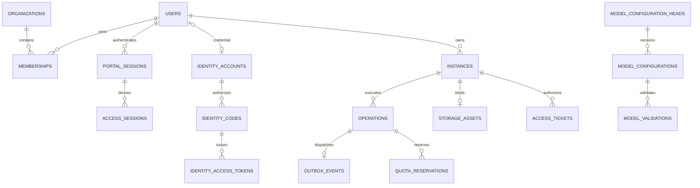
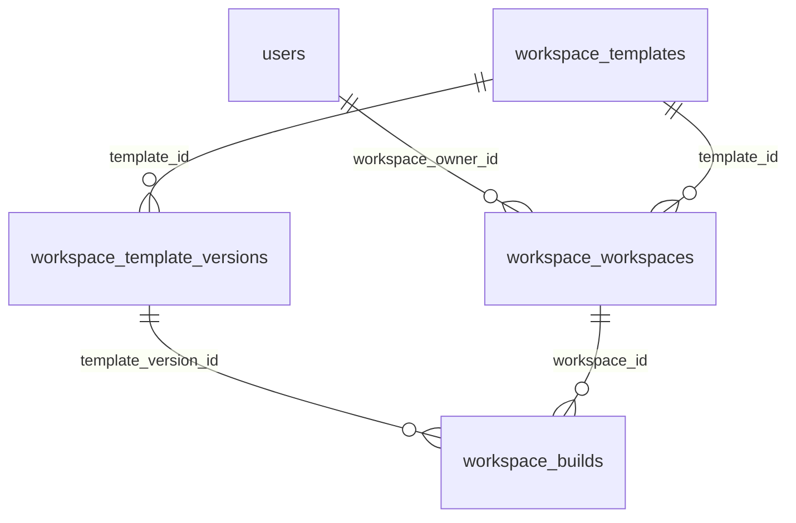

# DSH Cloud 数据与持久化设计

版本：V0.1。物理设计基线见 [PostgreSQL SQL](../db/schema.sql)，对应迁移见独立的db/migrations目录，应用启动只检查版本/校验和。全部业务事实由PostgreSQL持久化；Redis仅缓存/限流。

## 1 关系与命名

ID统一uuid v4、时间timestamptz、CPU millicores与容量bytes。API的model_configuration_id/version映射SQL的model_config_id/version；API模板template_version是内嵌TemplateVersion UUID。单组织仍保留org_id，复合FK限制Owner/配置/存储跨组织误绑定。

## 2 表职责

迁移11实现用户资料/状态、内置与自定义角色、固定权限、授权代次和身份供应操作。治理通过受控数据库函数保护最后管理员、版本及原子审计；Worker/Gateway不能修改角色权限。

模型配置使用platform-models/anthropic-messages连接、模型能力manifest、校验证据及有时效的目录摘要。迁移13～20补充个人模型、统一连接注册、同步任务、运行凭据及Owner约束。模型版本与实例快照不可变；只有显式应用才切换已有实例。

迁移21增加identity_password_resets。每用户最多一个PENDING任务，记录稳定任务ID、执行管理员、租约代次/到期、尝试数和安全原因；加密bcrypt散列只在PENDING期间保留，SUCCEEDED必须清空key_id/nonce/ciphertext。BEGIN原子写入意图/用户版本/撤销/审计，RETRY复用原密文与任务ID，CONFIRM在有效租约下清除密文并追加完成审计；提供方I/O不持有事务。元数据只向治理页面投影id/status/reason_code，禁止读回散列。个人提供商密文和待确认重置散列均纳入主密钥轮换。

迁移22增加model_gateway_checks，按org/owner/connection/version外键保存独立核对状态、checked_at/expires_at、下次检查时间及持久租约。HEALTHY约束有效期最多60秒；旧SYNCED版本升级初始化UNKNOWN，不伪造网关证明。API只读，Worker可领取和条件回写，Gateway只经受控hc_model_available查询可用性。状态改变与审计原子提交，收费能力证据仍保存在model_validations。失效/过期使个人默认选择及运行授权拒绝，保留连接版本与数据资产。

平台数据库为模型管理权威：model_providers、model_catalog_entries维护批准元数据；user_model_connections及versions绑定org/owner；external_provider_secrets保存真实Key的AES-GCM密文；model_sync_operations保存稳定远端ID、租约、结果未知和重试；user_model_defaults保存个人默认及CAS版本。secrets仅保存供DSH使用的虚拟密钥。API可写真实Key密文但不能SELECT其密文字段，Worker与原生模型入口受控读取，工作空间访问Gateway无真实Key权限。原生Go模型入口复用平台提供商密文；执行表仅保存路由元数据与运行密钥摘要，使用独立最小权限数据库角色。

| 表组 | 事实 | 关键约束 |
| --- | --- | --- |
| organizations/users/memberships | 单组织、OIDC主体、Workspace Owner映射、角色与代次 | 单组织unique true，issuer+subject唯一，Workspace Owner UUID唯一（workspace_owner_id） |
| portal_sessions/oidc_transactions | 服务端会话和一次登录事务 | 随机秘密摘要、浏览器state绑定、PKCE密文/12-byte nonce/key_id、过期/撤销 |
| secrets | AES-GCM密文、nonce、key_id、撤销 | 主密钥外置；应用绑定AAD；无明文 |
| model_configuration_heads/model_configurations | 单连接当前头与不可变版本 | org唯一头、(id,version)主键、credential org FK |
| model_validations/probe_budgets | 版本校验、探测租约、每日请求次数 | 每版本一行、每org/UTC日原子计数上限1000 |
| approved_templates/approved_specs | 锁定模板/manifest/digest与不可变资源规格 | 名称/正容量/digest检查；模板最多一个 enabled；批准 CPU 1000/2000/4000/8000/16000 millicores × 内存 2/4/8/16/32/64 GiB，存储 1–100 GiB 整数的批准组合；具备 bounded-ext4-v1 存储适配器的受控批准事务登记容量组合，业务角色不能插入规格；实例冻结 spec_id 与资源金额，停用不改旧快照 |
| organization_defaults | 当前默认项与version | 各引用FK，默认项更新仅影响新实例 |
| instances/instance_health | 快照、状态、Owner、外部标识、五维健康 | 活动名称唯一、Workspace唯一、UUID稳定、维度唯一 |
| storage_assets | 独立数据盘、卷、初始化、保留 | 不可变归属复合FK、每实例一个原资产 |
| operations/outbox_events | 持久意图、状态/租约/阶段、待执行任务 | 每实例活跃部分唯一索引、USER/SYSTEM发起类别、每操作一个Outbox |
| idempotency_records | 作用域、哈希、首次响应、操作 | 复合主键；活跃操作expires_at为空不清理 |
| quota_policies/quota_reservations | 上限与HELD/USED/RELEASED明细 | 正数/类型检查；每operation/type唯一 |
| recovery_quota_holds/quota_commitments | 恢复保留额度/统一配额读视图 | 按org/原instance/resource唯一，归属membership；普通服务不能修改保留额度 |
| access_routes/challenges/tickets/sessions/native_sessions | 固定IP/Host、挑战/票据/平台会话、加密原生Cookie | Host唯一、票据摘要/挑战唯一、实例进程代次 |
| audit_events | 追加事件与脱敏context | owner_id固定事件所属实例Owner；trigger阻止UPDATE/DELETE，可信保留维护见第9节 |
| audit_retention_holds | 组织审计法律保留状态、原因、操作者与变更时间 | 独立于到期事件；仅受信维护账户写入，状态变化同事务追加审计 |

SQL约束处理结构一致性；模板启用、状态合法转换、配额总量和凭据撤销需应用事务检查，不能声称CHECK约束涵盖全部业务规则。config_snapshot/intent/runtime_manifest均需版本化应用schema校验，禁止Key/Token/Cookie等秘密字段。

## 3 创建和幂等事务

READ COMMITTED + 显式行锁。需要多类锁时统一为membership（按user_id排序）→Portal session（涉及会话时）→配置头/目标版本→defaults→组织quota_policy→instance（按id排序）→operation（按id排序）→outbox→访问challenge→ticket→session。只锁用例所需的子序列，不在持有后序锁时补前序锁。Worker通过000002迁移的受控SECURITY DEFINER函数锁Owner membership与配置头，固定search_path并显式限定public表、撤销PUBLIC执行权，仅授予Worker执行；不向Worker授予身份表UPDATE权限。锁内无网络，新增行及外键检查也纳入事务设计；数据库并发测试须覆盖接受、终态、撤销和领取的组合。

配置撤销先在短事务锁配置头，撤销版本/credential并提交；这一步即阻断所有引用的创建/进入/探测结果发布。随后按实例分别走上述锁序关闭路由、推进代次和入队停止，由周期扫描补偿中断的批次。不能持配置头再逆序锁其他Owner的membership；原子失效由读取已撤销配置保证，不要求所有实例物理清理在一个大事务完成。全局限额只有锁定quota_policy后才能读/写账本。

创建先验证会话，再在事务内锁membership并重新确认active/代次，按幂等复合键查记录；同键匹配返回原响应。新命令锁配置头/默认项，读取一致模板/规格/模型/凭据，锁quota_policy后聚合未释放预留并校验组织/用户/计算/存储/并发额度。插入实例、操作、各预留、Outbox、审计和首次响应后提交。Unique冲突回滚整个事务，重新读取幂等记录比hash；不能只捕获异常继续使用已失败事务。

并发同Key先锁同membership而串行；跨用户由组织quota_policy串行限额。默认项更新锁配置头及defaults行，版本条件更新。配置校验/撤销与创建锁同一配置头，禁止撤销与创建交错放行。网络预检只提供提示，接受命令仍重新校验DB事实。

## 4 Worker领取与条件回写

领取仅修改operation/outbox，不锁或改instance/配额：先联查到期PENDING outbox与活跃operation，用`FOR UPDATE OF o SKIP LOCKED`只锁operation，再按operation_id锁outbox并重检状态/到期/租约。禁止先锁outbox再等待operation。每事务最多10项，已有有效租约跳过；更新lease_owner、递增lease_token、lease_expires_at=clock_timestamp()+60秒，首次转RUNNING。事务提交后执行外部查询/动作；每15秒条件续租。涉及instance/配额的阶段回写另开事务按第3节完整锁序，不能在领取事务中补锁instance。

阶段/状态回写使用 `WHERE id=$id AND lease_token=$token AND lease_owner=$worker AND lease_expires_at>clock_timestamp()`，并检查instance.version/目标意图。更新0行表示失租，立即停止后续动作。租约/票据/会话到期判断用数据库clock_timestamp()，不能用事务起始时刻now()把锁等待时间忽略；created_at等事件时间仍可用now()。外部返回迟到不意味着可回写；下一租约通过稳定Owner/name/build对账。UNCERTAIN保持槽与额度，Outbox仍PENDING、retry_at后移；终态和Outbox DONE同事务写入，幂等expires_at设终态后7天。

操作intent记录目标配置和所需实例版本，不含明文凭据。retry_of指向FAILED操作；重试前确保无活跃操作，重新预留仅已释放的额度，不能复制仍USED存储/实例账目造成双计。

model_validations.attempted_at使用数据库时间记录最近一次手动或自动校验领取，自动调度仅在4分钟后重新领取，跨Worker/重启共享；lease_token及45秒lease_expires_at另负责当前执行排他和终态发布。迁移000003从既有lease开始时间或checked_at回填attempted_at。Worker通过限定的hc_worker_lock_model函数锁定配置头，不能获得修改配置头/凭据绑定的权限；只可更新模型状态、validation检查字段及预算计数。每日预算按配置头→validation→预算行锁序，在全部等待结束后重查期限；计数与UTC日期不一致时拒绝预留。

## 5 配额与资源生命周期

配额通过quota_commitments聚合quota_reservations中的HELD+USED及全部recovery_quota_holds；单位一致。预检和锁定quota_policy后的命令接受使用相同视图。CREATE预留INSTANCE/RUNNING/CPU/MEMORY/STORAGE/CONCURRENT；START仅预留计算和CONCURRENT；CONFIGURE重启沿用现有计算额度，STOP/DELETE不新增额度。创建成功CONCURRENT释放、其余HELD→USED；确定失败释放仅已确认不存在的资源；不确定保留。Worker针对单个已存在实例的资源证明仍检查原quota_reservations，不能用恢复保留额度替代缺少的实例/操作/原盘关系。

停止成功释放RUNNING/CPU/MEMORY，INSTANCE/STORAGE继续USED；删除成功释放INSTANCE和计算，STORAGE仍USED，retention_until 从确认软删除的 deleted_at 起按组织 retention_days（缺失默认 7 天）设置，并保留已有更长期限；永久回收另须满足软删除后至少 7 天，法律保留优先。实际永久回收确认后释放STORAGE。CONCURRENT在确定启动完成/失败后释放，UNCERTAIN不释放。部分失败账本按实际资源确认，不能只看操作FAILED统一清零。定期对账仍需quota_policy锁，漂移向安全保守方向修正并审计。

若创建期间的安全STOP只能确认计算消失，尚未核实的数据资产对应STORAGE预留继续HELD，不能仅因STOP成功变为USED或RELEASED。SYSTEM STOP允许实例保留既有desired=DELETED意图，观察状态仅发布STOPPED，后续软删除仍须按删除用例确认并保留数据。

原卷PREPARING→READY→RETAINED→RECLAIM_PENDING→DELETED，停止不改变READY。受控恢复使用READY→RESTORING→READY；maintenance_intent记录schema_version=1、动作和已验证的source/backup/preimage摘要，不保存密钥或数据正文。RESTORING/RECLAIM_PENDING是持久阻断状态，普通Worker不得改为READY；中断继续需匹配原意图。缺原卷或初始化标记拒绝启动，不能替换storage_asset_id。每实例仍只绑定一个原资产；备份恢复写入同Owner、正常创建后已停止的另一个目标实例资产，原实例/原资产保留；恢复授权更新目标初始化标记并审计source_asset_id/target_asset_id/备份校验和，不把第二资产绑定到同一实例。

## 6 认证、撤销与加密

会话/ticket/challenge只存随机秘密摘要。Gateway消费事务按统一锁序锁挑战/票据，验证会话/Owner/两种代次/状态后条件UPDATE consumed_at，并插access_session；并发只一次。详见安全文档。原生Cookie另存AES-GCM密文，按instance/runtime_generation绑定，绝不进入普通JSON快照。

secret记录不能由普通实例读API解密；服务进程数据库角色按表最小权限。API不得修改approved_templates和物理卷状态，Worker不得改变用户角色。审计普通角色INSERT/SELECT，保留维护使用独立受控角色；trigger禁止改写，清理采用离线受控归档/分区管理并记录维护审计。

撤销配置需要引用同credential_ref全部版本失效；受影响实例增加access_generation并阻断新运行。operations/instances增加的撤销意图存intent与desired_state；若已有操作，Worker在每检查点重新校验配置撤销，安全停止通过当前操作对账后另建系统停止操作，不插第二活跃操作。系统停止使用actor_kind=SYSTEM、actor_id=NULL、type=STOP，intent.reason记录失权/凭据撤销；用户操作为USER且actor_id必填。Worker用受信服务身份执行清理，不因原Owner被禁用而跳过停止；SYSTEM不能创建/启动/配置/删除。

迁移000004提供 `hc_access_lock_principal` 与 `hc_access_lock_instance`：按 membership→Portal session→配置头→实例→challenge→ticket→Gateway session 的子序列锁定，只授予 API/Gateway 指定函数执行权，不授予身份表修改权限。锁等待结束后重新检查绝对到期、空闲期限、主体代次和访问代次；不能使用等待前的时间或授权。新挑战替换旧挑战时先锁实例，再作废旧挑战，避免外键检查与消费事务形成反序死锁。

## 7 迁移与备份

数据库文件统一存放在独立的db目录。db/schema.sql用于设计和空库验证，开发时按版本在db/migrations建立迁移文件及迁移记录；docs目录仅保存设计说明。运行应用不能自动破坏性改表。迁移账户与运行账户分离，不依赖超级用户。迁移按连续版本依次执行并逐条验证校验和；旧版本、额外记录或任意校验和变化使应用就绪失败，独立迁移器在事务/排他锁内升级。升级expand→migrate→contract，备份主密钥与DB不同故障域。PG和卷独立恢复，恢复后撤销全部Portal/Gateway会话并重建原生会话，校验Owner与配置版本后开放。

索引覆盖Owner游标分页、活动操作/租约、Outbox待执行、配额聚合和审计。大表查询EXPLAIN和容量压测在D2进行；生产保留数据不使用级联DELETE。SQL结构检查不替代并发集成测试。

## 8 持久JSON与版本语义

| 字段 | V0.1应用校验与行为 |
| --- | --- |
| instances.config_snapshot | schema_version=1；其余字段与OpenAPI ConfigurationSnapshot一致。密钥引用从绑定的model_config_id/version解析，不把Key或原生Cookie写入快照 |
| operations.intent | schema_version=1、expected_instance_version、target_desired_state、reason（USER_REQUEST/AUTH_REVOKED/CREDENTIAL_REVOKED）、request_id；CREATE/START/CONFIGURE携带冻结的target_snapshot，DELETE保存confirmed_name；Worker 可追加 external_build（schema_version=1、before_build_id、before_build_number、template_version、transition、phase、build_id、completed），模板必须等于冻结快照；发送前持久化，恢复只确认匹配后继而不盲目重发。所有用户操作保存accepted_auth_generation，Worker每检查点重新校验当前身份/配置；代次变化先按当前权限重新鉴权，失权转安全清理，不仅比较旧代次数值 |
| approved_templates.runtime_manifest | schema_version=1及后端第12.2节全部必填字段；实际commit/digest/Provider/模板/profile/工具策略由D0锁定，未知字段拒绝 |
| audit_events.details | schema_version=1；仅允许operation_id、instance_id、reason_code、source_asset_id、target_asset_id、backup_sha256、key_id、operator_ref及变更版本等安全元数据，禁止原始请求/上游body |

持久JSON由各模块显式类型解码并校验，未知schema_version阻止相关任务且安全告警；升级读取旧版需先提供转换器和fixture，不默认反序列化为任意map。

Instance.version在接受新命令、执行器提交新的状态/快照或安全意图时递增；只读查询、租约续期和健康刷新不递增。Worker回写成功后使用返回的新version继续执行；过期expected_instance_version返回409。access_generation仅在撤销/停止/删除/配置重启等安全边界递增，runtime_generation每次DSH进程启动生成新UUID，不能把三者混为同一计数。

## 9 保留清理与数据库权限

每5分钟以最多500条一批清理到期OIDC事务、challenge、已过期且无有效引用的ticket/Gateway/Portal会话与终态超过7天的幂等记录。按ticket→challenge及Gateway session→Portal session的引用依赖顺序删除，不能对仍被有效票据/访问会话引用的Portal行做级联删除；过期判定先拒绝访问，物理清理失败不延长授权。OIDC临时Cookie随消费/到期清除。业务实例/操作/Outbox/配额记录首版不自动硬删，审计关联保留。

审计保留90天只是可归档下限，不是普通角色DELETE许可。`AuditArchiver`已实现受控维护归档：同一事务锁组织、保护法律保留表及资产表，再排他锁审计表；最多500行、单行2MiB、单批16MiB，完整导出所有原字段为JSONL，经独立密钥加密、完整回读认证、排他发布和fsync后才删除选定旧行。指定append-only trigger的暂时禁用、删除、立即恢复和维护审计同事务，失败整体回滚；普通API/Worker/Gateway仍无DDL或DELETE许可。锁等待1秒、SQL4秒、事务空闲10秒、操作30秒上限，需协调维护窗口；长时间存储不可用时原记录继续保护。

`audit_retention_holds`按组织保留独立法律状态，不随审计归档消失。组织保留生效或该组织任一资产具有legal_hold时，保守保留整个组织审计；`audit-hold`只改变组织审计保留，不解除资产法律保留。变更必须带安全原因码、操作者、精确组织确认及维护状态，预览和精确状态重放不写入。归档末尾失败可能留下已验证密文，原记录和trigger仍回滚，须核对维护审计后用新文件名继续，不覆盖已有归档。分区化属于独立迁移。

D1迁移必须提供角色GRANT矩阵和测试：API可读授权与业务事实、写用户命令/密文配置/挑战票据；Worker可写操作/健康/配额/存储/路由、读必要模型密文，不能改身份角色；Gateway可读当前授权/路由、仅更新Portal last_seen_at及访问挑战/票据/会话，读取Worker加密发布的原生Cookie，不得读取模型密文或改实例/额度；前三类进程按职责仅追加审计；原生模型Gateway使用hc_model_gateway，仅读必要授权及模型密文、仅写模型执行路由与运行密钥两表。身份初始化和备份/回收/DDL使用独立受控角色。按列或专用数据库函数限制更新，不能简单向全部进程授予整库写权限。

锁与时间依据：[PostgreSQL行锁](https://www.postgresql.org/docs/17/sql-select.html#SQL-FOR-UPDATE-SHARE)、[数据库时间函数](https://www.postgresql.org/docs/17/functions-datetime.html)。

隔离恢复资源登记复用追加审计表：action=RECOVERY_INVENTORY，details含schema_version=1、operator_ref及report（run_id、snapshot_sha256、findings、ledger、conservative、blockers、quarantined、promotion_allowed）。元数据只含归属标识/资源状态/容量，不含凭据或工作正文。报告与审计为同一不可变行，不另建可被普通进程修改的资源影子表；精确摘要重放返回原行。conservative只用于恢复阻断与后续账本接管，原quota_reservations不减少，组织保持DISABLED且promotion_allowed恒为false。

schema8增加recovery_quota_holds及quota_commitments视图，SQL独立保存在db/migrations/000008_recovery_quota_holds.sql。保留行不引用不存在的instances/operations；保留原instance UUID、真实归属Owner、resource_type、正数amount、来源核对run_id/摘要、原因码、操作者和时间。org/Owner复合FK关联membership，org/instance/resource唯一防止同资源重复保留或换Owner。只允许受信运维在已隔离恢复库追加或上调缺额，原quota_reservations保持；已有额度与同身份物理盘/卷取最大值，不同盘累加，缺失资源不释放，超界/溢出拒绝。已核实存在的漏记实例仍消耗INSTANCE及本人上限，保留的计算消耗RUNNING/CPU/MEMORY；超配额恢复保留可记录真实债务，后续创建/启动继续拒绝。

RECOVERY_LEDGER_RETAIN审计与保留行同事务提交，details保存原核对ID、操作者/原因、数据库/外部/Owner映射/提交后保留摘要及差额报告。精确重放需摘要和意图一致，审计失败所有保留写入撤回；后续Inventory报告的ledger包含已接管额度。普通API只有quota_commitments只读权限，Worker/Gateway不能修改或释放保留额度；任何普通启停/删除/过期清理均不能降低它。该步骤持续禁用恢复组织、凭据及服务CONNECT，不创建可访问的替代实例；解除保留、资源正式接纳或授权切换另需受控流程与验证。

可信检查点接纳复用schema8，不新增业务替身表：导入原UUID、冻结配置、原资产/终态操作/原quota_reservations后，在同一事务删除对应recovery_quota_holds并追加RECOVERY_RESOURCE_ADOPT。quota_commitments前后逐维相等；保留额度转换不会释放容量，后续软删除/保留到期/物理回收仍走正常受控规则。原target业务行不覆盖，模板/规格enabled保持，新增者禁用；现存REVOKED秘密保留其原密文/撤销时间，新增密文仅REVOKED，模型头取单调最大值。来源仅已认证备份的独立隔离库，不导入身份、默认项、会话、路由、Outbox或幂等许可；实例访问代次和终态操作租约代次推进。精确重放以追加审计中的源检查点/元数据及目标后置摘要为准。

来源授权隔离沿用schema8和追加审计，不新增表。RECOVERY_SOURCE_FENCE与来源组织/成员代次/会话/模型凭据/健康/实例访问代次及库CONNECT撤销同事务，details包含操作者/原因、目标库/核对ID、来源预期资源摘要、提交后来源授权摘要、目标授权摘要和外部观察摘要；不包含密钥或工作正文。原实例快照/资产/预留/密文与probe_budgets保持。提交后关闭来源服务连接，再以RECOVERY_SOURCE_DRAIN绑定fence_run_id；该第二阶段失败不会复活第一阶段授权，精确重放复用原两条记录。目标授权及业务数据全程不写入。

DELETED实例的保留盘保持STORAGE承诺；仅存在原ASSET/VOLUME时不补记已释放INSTANCE。未知资源及残留Workspace/计算/网络继续保守占额，缺失观察不能释放既有恢复保留。

## 内嵌 Workspace、模板和构建

schema9新增5张workspace_*表，迁移独立保存在db/migrations/000009_embedded_workspaces.sql。workspace_authority保存固定组织与控制主体；workspace_templates保存模板身份/当前版本；workspace_template_versions保存不可变三文件源码、摘要、file ID和创建者；workspace_workspaces保存Owner、稳定名称、模板和软删除；workspace_builds保存连续构建号、transition、精确模板版本、发起者、Job状态、固定参数、私有Terraform state及时间。每Workspace单个pending/running构建由唯一部分索引保证。

schema 10 将平台业务列改为 users.workspace_owner_id、instances.workspace_name、instances.workspace_id，保留原 ID、外键及列授权；实例 API 对外输出 workspace_id，内部 Owner/name 不从请求覆盖；业务列不提供旧别名。计算容器标签使用 hc.workspace_owner_id 和 hc.workspace_id。Workspace元数据与平台事实共用PostgreSQL并一同加密备份；API/Gateway没有provisioner_state读取权限、没有模板写权限；Worker不能修改模板，只能执行已固定版本。成套恢复保留原Owner、Workspace、TemplateVersion、Build、Job ID、构建时间及Terraform state。

Workspace 持久化关系如下；图中 Owner 为 `users.workspace_owner_id`，平台 `users.id` 仍用于 Membership、实例 Owner、会话及审计。

`workspace_authority` 固定编排组织及控制主体，不要求其组织 UUID 等于平台组织；应用层同时核验 Workspace、TemplateVersion 的组织和 Build 发起者。`instances.workspace_id` 保存关联，执行时重查稳定 Owner/name/参数/资产，而非仅凭一个 UUID 信任计算资源。

模板发布在同一事务内写 Template 与不可变 TemplateVersion，当前版本 FK 延迟到提交校验；批准模板是平台准入记录，与编排模板源码版本分开。连续 Build 号和单活跃 Build 索引负责计算构建排他；平台单活跃 Operation 另有索引。Terraform state 属于构建私有数据，只由受信 Worker 与迁移/恢复工具使用，不经 API、日志或 Redis 输出。

## 个人模型约束

model_connection_registry统一组织共享与用户私有模型的版本引用，owner_id为空代表组织连接。复合外键限制组织、Owner、连接和真实Key的混用；hc_model_available及实例写入触发器阻止跨Owner绑定。组织默认触发器拒绝使用私有连接。个人默认清除保留递增版本和空绑定，避免旧请求跨清除覆盖；创建只读取非空绑定。同步成功只生成UNVALIDATED，真实校验才产生VALID。撤销先封闭本地使用，再异步删除网关Key/路由；所有版本均撤销后且无引用才允许归档。

迁移20增加受限个人模型补偿函数，用户、组织、成员关系、目录或提供商失效时按版本撤销与排队删除；后台注册前后重新校验当前角色的个人模型写权限。函数不向API或Gateway开放，调用健康连接不产生变更。

## 内置 OIDC 持久化

身份迁移独立存放于 `db/migrations/000023_internal_oidc.sql`，新增4张身份表。`db/schema.sql` 汇总当前24个迁移，平台共58个public表/视图（含迁移账本）；应用要求完整版本和校验和。

| 表 | 权威内容与约束 |
|---|---|
| identity_accounts | 稳定UUID、固定组织、可选平台user_id、组织内唯一小写登录邮箱、显示名、60-byte bcrypt散列、credential_version、enabled；user_id唯一。无平台映射的受控账号可完成身份验证但不能进入业务 |
| identity_authorizations | 独立UUID，浏览器/CSRF 32-byte摘要，客户端/回调/state/nonce/S256 challenge/scope，失败次数0～10、5分钟期限和一次消费时间 |
| identity_codes | 独立UUID与唯一32-byte授权码摘要，账号FK、客户端/回调/nonce/challenge/scope、权限代次、凭据版本、认证时间、60秒期限、消费时间 |
| identity_access_tokens | 独立UUID与唯一32-byte随机Token摘要，授权码/账号FK、scope、权限代次、凭据版本、5分钟期限和撤销时间；授权码索引支持重放撤销 |

账号创建只插入，不因幂等重试替换已存在散列。重置同散列重放不再次推进 credential_version；实际新散列写入推进版本。密码不与模型 secrets 混存，不进入用户详情/审计。API具有上述表读写权限；Worker只有受控清理函数权限，Gateway无账号表权限。

清理保持全局每批最多500行，先Token、再没有Token引用且到期超过5分钟的授权码、再到期/已消费登录挑战，然后在剩余额度内执行原平台会话/幂等清理。访问按期限立即失效，不依赖物理删除。来源恢复围栏锁定全部身份表；隔离恢复撤销挑战、授权码和Token，包括旧版本备份缺表时的兼容判断。签名私钥不在SQL或数据库中，由受控文件单独备份。

## 原生模型执行元数据

schema24共58张public表/视图（含迁移账本）。`model_providers.adapter_prefix`指定固定Go适配器。`model_gateway_routes`保存稳定UUID、org/owner/connection/version复合归属、独立唯一别名、冻结参数及启用状态；CHECK禁止api_key进入JSON，不另存真实密钥。`model_gateway_keys`保存32bytes SHA-256摘要、唯一route_id、撤销时间及分钟窗口计数（0～60）；不存在明文Key列或可覆盖路由/权限字段。

hc_model_gateway可读模型和授权元数据、提供商及运行密文，仅可写两张执行表；不可读登录散列、修改身份、实例、配额或运行模板。hc_api不可读提供商密文，hc_worker负责注册，工作空间hc_gateway不读密文。恢复隔离必须禁用路由、撤销运行密钥并禁止四类应用账号CONNECT；来源围栏包含两个执行表及原生模型连接。模型入口不缓存跨请求授权，停用用户/目录或本地撤销使下一次请求拒绝。

schema 25通过`000025_custom_model_catalog.sql`增加`model_catalog_entries.owner_id`，复合外键绑定组织成员。NULL代表组织共享目录，采用部分唯一索引；非NULL代表本人私有不可变模型能力快照，同一模型变更能力会创建新快照，原连接manifest不变。读取、使用及目录管理服务显式执行Owner隔离，管理员目录API只管理共享行。增加`custom-openai`/`custom-anthropic`适配器目录元数据，自定义HTTP只在这两种provider允许；实际根地址仍由受控配置共同批准。未引用的已下线DeepSeek/Kimi旧默认停用，现有绑定保持版本不被改写。

schema 36通过`000036_openai_responses.sql`增加独立`custom-openai-responses`适配器ID，协议在账号创建后冻结；它使用OpenAI Responses API，Chat Completions账号不受影响。自定义模型缺省能力为上下文131072、输出16384，用户可按实际模型能力调整。

## 用户资源配额（schema 26）

迁移 `000026_user_resource_quotas.sql` 添加 `user_quota_policies`：主键 `(org_id,owner_id)`、成员复合外键、组织配额外键、正数版本、实例数量/CPU/内存/持久存储四项非负 bigint 上限和更新时间。迁移 `000039_default_user_quota.sql` 在用户创建事务中，按组织运行默认规格与每用户默认实例数写入个人初始额度，CPU、内存、存储按规格乘实例数并封顶于组织上限；默认配置变更不覆盖已有个人额度。既有用户及运行默认尚未初始化时创建的用户仍按缺行规则继承组织默认。配额绑定不可变用户 ID，授权与个人模型规则保持原样。

管理员配额调整、创建、启动和运行重试在事务内使用相同 `quota_policies FOR UPDATE` 锁。修改前聚合统一 `quota_commitments`，拒绝低于占用或高于组织总上限的值，版本竞争不覆盖；调整记录前后值与版本的追加审计，末尾失败回滚。API仅有新表 SELECT/INSERT 及必要列UPDATE，Worker/Gateway无需该表写权限。备份包含此表，恢复占用仍通过统一视图计入用户上限。

## schema28：个人模型提供商账号

schema28使用personal_provider_accounts保存org/owner、名称、固定提供商/API根、聚合版本、ACTIVE/DELETING/DELETED状态及创建请求/幂等摘要。user_model_connections通过provider_account_id关联账号，通过provider_retired标记移除状态，复合外键确保模型和聚合的org/owner一致。密钥继续保存在原external_provider_secrets，不新增密文列或明文Key。升级把每个未归档旧连接登记为独立聚合，保留原模型ID、Key、版本及工作空间绑定；同名记录不自动合并。schema28共60张public表/视图（含迁移账本）。

命名迁移db/migrations/000028_provider_account_naming.sql使用原地重命名，账号/模型ID、密文及实例引用保持不变，受控凭据函数同步为hc_personal_provider_account_credential。

每日备份一致性指纹纳入模型提供商账号完整元数据；新增、修改及状态变更必须使指纹变化，防止备份期间账号变更被忽略。

资源规格由迁移 29 为现有默认运行环境补充，新增环境由 runtimeapproval.Approve 原子初始化；迁移不放宽已有组织或用户额度。规格目录业务账号只读，不能提交任意 CPU/内存金额。迁移 30 将身份成员锁调整为 FOR NO KEY UPDATE，继续串行化权限变更，同时允许配额审计的外键引用锁，避免创建与管理员调整额度的锁环。

## 实例数量统一上限

迁移 `000031_unified_instance_quota.sql` 删除组织与用户配额表的 `max_running` 列，保留实例数量、CPU、内存和持久存储额度及全部占用记录。组织运行预留仍由同一个 `max_instances` 上限约束，用于保守核算恢复资产；RUNNING 账本保留生命周期与重试去重作用，不再代表独立可配置额度。迁移递增现有配额版本，阻止升级前打开的编辑器覆盖新配置。旧迁移校验和保持不变。

## 模型提供商账号默认模型（schema32）

000032_provider_default_models.sql增加personal_provider_accounts.default_model_id，使用org+owner+model的复合外键。服务端进一步验证模型属于目标账号且未归档/撤销。保存稳定ID，创建时解析当前版本。迁移优先保留属于本账号的现有个人默认，否则选择本账号首个启用模型；递增账号版本，保留模型ID、密文、实例快照和数据资产。撤销模型原子清空对应账号默认，聚合编辑移除默认时在同一事务选择保留模型。审计扩展读取既有details，不另建历史表。

迁移 000033 放宽 `instances.name` 为 1–32 个 Unicode 字符，支持中文、字母、数字、下划线及短横线；数据库以 `char_length` 计数，并限制为字母数字和上述分隔符。活动名称的组织内唯一性、不可变性以及 UUID 派生的运行标识保持原契约。

## 运行默认值独立初始化（迁移 34）

organization_defaults.model_config_id/model_config_version 可同时为空，配对 CHECK 禁止只填一项；非空时仍以组织模型归属触发器拒绝个人连接。retention_days 为整数，数据库限定 1–365，默认 7。GET 对空模型映射为空字符串/0，不泄露个人模型或凭据。实例解析以运行默认值为主、模型可选关联，实际选择的账号模型仍通过独立 Owner/有效版本/凭据/能力及网关检查，不依赖组织模型头存在。

保存先按组织串行化首次初始化，再锁运行默认值与 quota_policies，核对版本和继承用户占用。默认实例上限的修改推进配额版本，并与默认值、审计一同提交。API 仅获 quota_policies 的 UPDATE(version,max_user_instances) 列权限，不能借此批准规格或放宽组织计算/存储额度。Worker 确认软删除后读取保留期限，GREATEST 保证现有资产期限不缩短；期限到达不自动清理数据或释放存储账本。

### 存储观察与备份历史（schema43）

迁移 `000043_storage_management.sql` 为storage_assets添加usage_used_bytes、usage_available_bytes、usage_sampled_at、usage_attempted_at、usage_error。用量三字段须同时为空或有效非负且总量不超过capacity_bytes；真实0与未采集可区分。失败保留最后成功观察。

storage_backups保存组织/Owner/实例/资产复合绑定、冻结容量、模板版本和镜像摘要、RUNNING/SUCCEEDED/FAILED/UNCERTAIN/PRUNE_PENDING/PRUNED状态、创建/完成/校验/有效期、备份摘要、日备份集ID及私有archive_path。SUCCEEDED强制完整成功证明；同资产仅一个RUNNING/UNCERTAIN。API仅获安全列SELECT，不能读archive_path或写备份/用量；Worker仅按职责更新用量，不能发布备份成功。历史归档不自动回填成功记录。

### 本人手动释放（schema44）

迁移44新增 `instances:release-storage`（依赖instances:read），赋予内置角色；自定义角色需显式分配。storage_release_requests以asset_id唯一，保存原组织/Owner/实例/资产复合关联、用户确认名称、ACCEPTED/RUNNING/UNCERTAIN/SUCCEEDED、重试和完成时间。OWNER_RELEASE维护意图和请求ID共同绑定原任务。API仅可读取/插入请求和写资产维护状态；Worker可更新请求、维护状态及职责内配额账目，二者均不能删除请求。审计失败整笔回滚，物理结果未确认不释放存储额度。

### 固定目录只读浏览（schema45）

迁移`000045_storage_file_browsing.sql`新增短时`storage_browse_requests`，以组织、Owner、实例、资产复合外键约束请求归属；每个资产最多一个QUEUED/RUNNING请求，记录固定根、相对路径、分页游标、操作状态及不超过2分钟的过期时间。文件读取请求保存API的一次性X25519公钥；Worker仅写入AES-GCM加密结果，API持有私钥在本次请求内解密，避免数据库WAL和备份持久化明文。API处理后删除结果行，Worker定期清除过期请求。API只能SELECT/INSERT/DELETE，Worker只能SELECT/UPDATE/DELETE；该表不用于审计或长期文件缓存。
