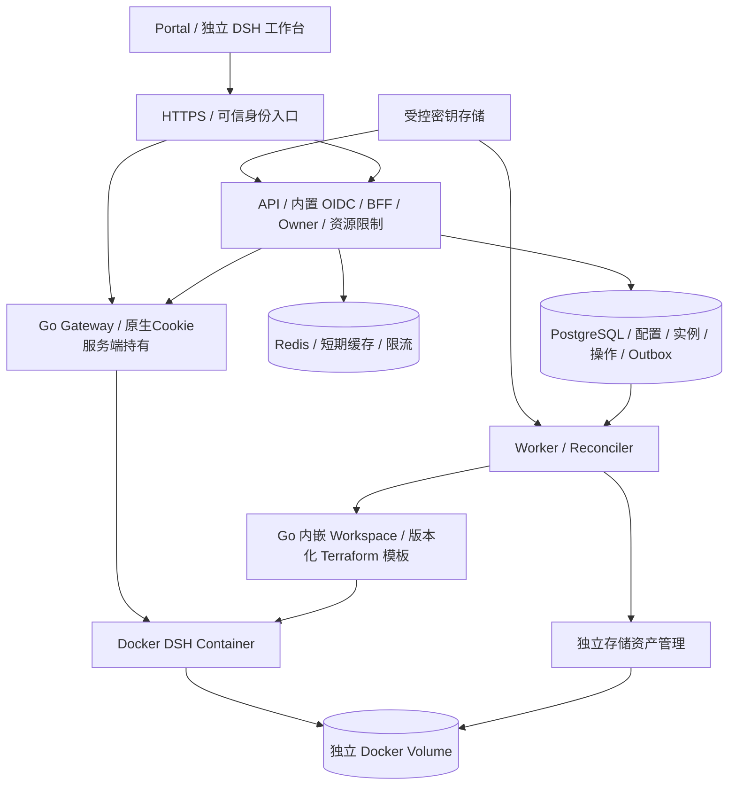
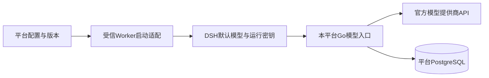
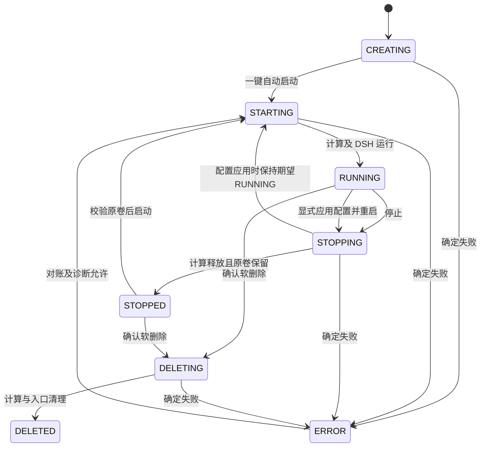
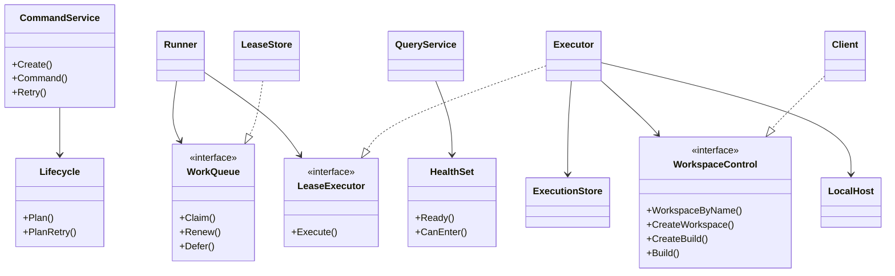
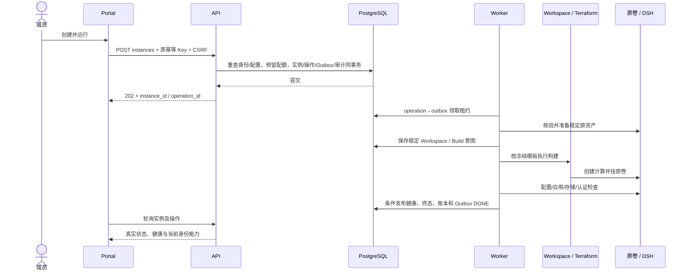
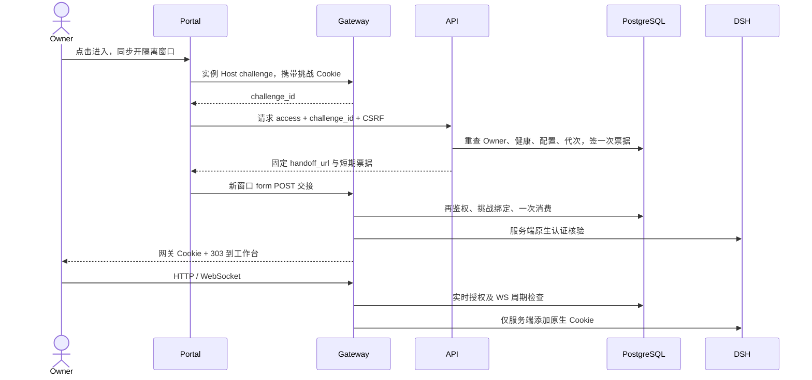
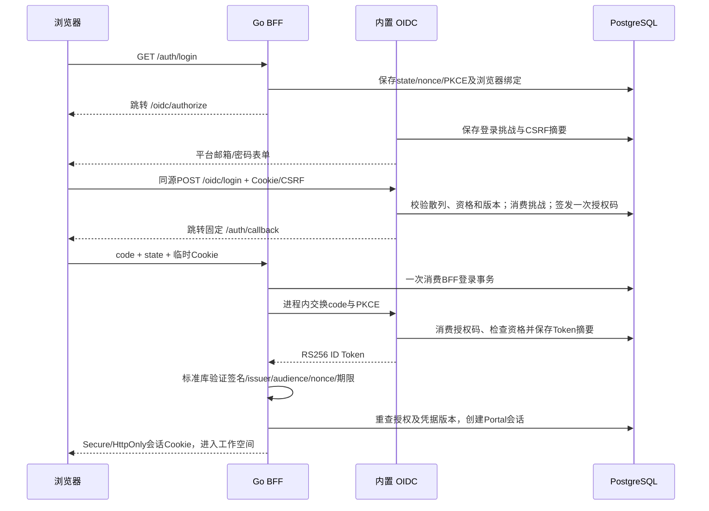

# DSH Cloud 系统设计

版本：V0.1。状态：开发设计基线，已有运行实现。范围依据 [功能需求](requirements.md)。

REQ-13～15由用户/角色应用服务、固定权限目录、事务内授权与会话撤销实现，Portal提供用户/角色管理页面；规则见[功能需求](requirements.md#64-用户管理规则req-13)。治理使用版本和追加审计保护并发边界，登录身份由平台内置 AuthorizationServer 与数据库 Accounts 供应。接口实现、模块测试与完整真实验收的边界见[测试设计](testing.md)。

## 1 初始版本架构

图示逻辑职责，可合并部署，但合并进程不得扩大密钥和 Docker 管理权限。后端采用 Go + Redis + PostgreSQL；Redis 用于缓存/限流，PostgreSQL 保持持久化权威，平台自身不另引入独立消息队列或拆分多个业务微服务；持久化可靠性和独立存储生命周期不能省略。

REQ-16～17由本平台Go模型入口直接调用外部提供商。平台PostgreSQL维护提供商目录、每用户私有连接、密文真实Key、运行密钥摘要、版本及同步任务；不增加模型代理依赖或独立模型数据库。工作空间访问Gateway负责浏览器授权，model-gateway负责模型请求，两者账号与权限分开。

配置、同步、真实能力校验、快照及撤销规则见[模型需求](requirements.md#68-用户私有模型与平台统一管理req-17)和[后端适配](backend.md#127-平台模型网关适配)。模块验证不替代TC-61～76完整产品验收。

| 模块 | 初始版本职责 |
| --- | --- |
| Portal | 一键创建、列表/详情、管理员配置与诊断 |
| API/BFF | Go 可信身份、Owner、固定配置、限额、命令、审计 |
| Redis | 脱敏短期缓存和原子限流，不作为权限/配额/操作的唯一依据 |
| Worker/Reconciler | 存储/配置/Workspace Build、健康、超时和配额对账 |
| Storage | 独立卷登记、归属、保留和受控回收 |
| 访问模块 / Gateway | 固定路由、浏览器挑战/票据、服务端原生会话、HTTP/WS与撤销 |

Workspace/TemplateVersion/Build 模块内嵌 Go 后端，元数据与业务事实共用平台 PostgreSQL；Terraform/Docker 外部效果仍通过操作记录、Outbox、幂等和对账实现最终一致性。运行后端仅 Docker。

工程采用 Go 模块化结构，API 与受信 Worker 分进程，API 不挂 Docker Socket。Gateway 采用 Go 访问模块和标准反向代理，独立实例子域；首版不开放 Coder App/端口代理作为第二用户入口。挑战/票据与服务端原生Cookie方案见 [安全](security.md) 和 [运行适配](backend.md#12-运行适配与外部契约)。详见 [后端技术架构](backend.md) 与 [前端技术架构](frontend.md)。

## 2 领域与配置

一个固定 Organization 下有 User/Membership、固定 Template/Spec、ModelConfiguration、Instance、StorageAsset、Operation、QuotaReservation、AccessRoute/Ticket 与 OperationLog。

模型配置有版本和凭据引用。默认项是新实例的输入来源；实例创建时保存不可变配置快照，既有实例显式应用后才更新。凭据撤销优先于快照，失败回退不得启用已撤销密钥。物理约束见 [数据设计](data-model.md)。

## 3 实例与操作状态

desired_state：RUNNING / STOPPED / DELETED。
observed_state：CREATING / STARTING / RUNNING / STOPPING / STOPPED / ERROR / DELETING / DELETED。

ERROR 恢复目标由诊断决定，图中不表示所有错误可启动。DELETED 只表示业务/计算删除，数据回收单独跟踪。初始版本一键路径始终自动启动。

操作状态：ACCEPTED → RUNNING → SUCCEEDED / FAILED；外部动作无法确定时 RUNNING → UNCERTAIN，经对账回到 RUNNING 或进入终态。UNCERTAIN 仍占活跃操作槽和未确认资源额度。NEEDS_REVIEW 是诊断原因，不能当实例枚举。

每实例只有一个 ACCEPTED/RUNNING/UNCERTAIN 操作。状态版本和租约同时防止旧执行器回写；租约失效后先核实外部动作。它们不能撤回已经发出的外部请求；须持久化稳定创建标识，复用同一 Owner/Workspace 名称，并验证外部唯一性、冲突与迟到成功。无法安全确定时继续对账，禁止换名重建。成功停止/删除要求确认入口撤销与计算处理；开始请求返回 202 不代表执行完成。

## 4 就绪与进入

| 维度 | 状态 | 依据 |
| --- | --- | --- |
| 应用 | UNKNOWN / CHECKING / HEALTHY / UNHEALTHY | DSH 必需检查、Agent、Web/RPC |
| 存储 | 同上 | 原卷、归属、初始化、读写 |
| 配置 | 同上 | 已注入且版本符合快照 |
| 访问 | 同上 | 固定域名、TLS、路由、原生认证可用 |
| 模型 | 同上 | 指定模型有限真实调用，不只检查连通 |

每项保存 checked_at、expires_at 和脱敏原因；过期按 UNKNOWN 判断，探测频率、合并和持久次数预算以 [配置基线](deployment.md#8-配置与业务规则基线) 为准。

ready 要求 RUNNING、上述五项全部健康且结果未过期。can_enter 额外依赖当前调用者的平台/Workspace Owner 权限；应用、存储、配置和访问必须健康，但模型故障允许授权用户进入诊断，并显示降级。can_enter 按请求身份计算，不作为全用户通用的持久化许可。

运行后的模型失败不改变计算 RUNNING，但 ready=false。存储异常应阻断操作并诊断，不尝试创建空卷。健康快照不替代实际访问时的再次鉴权。

## 5 一键创建与可靠执行

1. 校验身份、默认配置版本、授权、模型校验有效性和资源限额。
2. 单事务预留配额并写 Instance/Operation/Outbox/审计，提交后 202。
3. Worker 以租约领取，验证资源和操作版本，准备独立卷。
4. 内嵌 Workspace 模块按固定模板构建计算，受控注入 DSH 配置/模型凭据并自动启动。
5. 记录 Workspace/build ID，检查运行、配置、存储、应用、访问和模型。
6. 持久化阶段与健康；操作成功代表创建运行编排完成，ready 另反映可使用条件。若首次模型/访问等必需检查失败，创建操作 FAILED 并说明已存在的计算/卷，不能虚报全流程成功。
7. 定期对账操作、资源、卷与配额。修复配置后对原实例重新检查或安全应用，不丢数据。

模板与配置格式、原生 Handoff、模型工具能力按[运行适配](backend.md#12-运行适配与外部契约)的固定版本契约验证。不得解析普通日志中打印的带 Token URL 来实现正常就绪链路。

## 6 停止、删除与故障

停止先撤销入口/票据再释放计算；启动验证同一卷。卷由受信存储模块独立管理，不能属于 Workspace Terraform 销毁资源；同时防止挂载不存在卷名隐式创建空卷。软删除确认后清理计算/入口，保留资产。配额按实际资源释放，未知外部动作先保留相关额度。

CONFIGURE对RUNNING实例固定执行受控重启：接受事务推进access_generation、关闭路由，操作保持desired=RUNNING并进入STOPPING；Worker正常退出/刷盘→应用目标配置→STARTING→检查→RUNNING，计算额度沿用不重复预留，健康通过后才开放入口并提交新快照。STOPPED实例只更新下次启动配置，不启动计算。目标配置在每检查点重新验证未撤销；失败保留数据并关闭入口，仅在旧版本仍有效且兼容时受控恢复，否则ERROR并等待修复。

| 故障 | 必须行为 |
| --- | --- |
| Workspace/Terraform 超时 | UNCERTAIN，按 Workspace/操作关联对账 |
| Worker 中断/重复 Outbox | 新租约先确认外部动作，拒绝旧租约回写 |
| 建成但 DB 回写失败 | 用不可变资源标签对账，不再创建第二资源 |
| 原卷缺失/归属错误 | ERROR，拒绝挂载，人工恢复 |
| 模型配置无效 | ready=false，脱敏诊断和有限重校验 |
| 访问授权不可用 | 拒绝代理，不把缓存旧许可当成功 |
| 删除/配额释放失败 | 保留可追踪记录，核实后修复 |

## 7 实施依赖

存储、Workspace 编排、配置注入与访问代理保留清晰职责，可合并部署。数据回收必须独立授权，不能随计算清理自动销毁卷。

接口见 [API](api.md)，安全见 [安全设计](security.md)，决策见 [ADR](decisions/README.md)，实施顺序见 [功能需求](requirements.md#9-实施顺序)。对象职责与依赖方向见 [面向对象详细设计](design.md#8-面向对象详细设计)，事务见 [数据设计](data-model.md)，开发依赖见[实施顺序](requirements.md#9-实施顺序)，当前验证范围见[测试验收](testing.md)。

## 8 面向对象详细设计

### 8.1 设计原则

Go 使用 struct、方法、小接口和组合封装规则，React 使用函数组件和类型化客户端。规则对象按值规划状态变化；应用服务在短事务内重查授权、配置、版本和配额后提交。避免类继承框架、通用 BaseService、万能 Repository 和只用于转调的接口。

当前为模块化单体：纯规则对象 `instances.Lifecycle`、`QuotaPolicy`、`HealthSet` 不执行 IO；同包的 `CommandService`、`QueryService` 使用 pgx 实现事务和投影。这是代码的实际边界，不要求先拆出空的 domain/application/repository 目录。HTTP DTO、持久化快照和运行观察分别校验，不能把浏览器字段作为已核实的资源事实。

依赖通过构造函数或使用方小接口注入。Worker `Executor` 消费 `WorkspaceControl`，`Runner` 消费 `WorkQueue`/`LeaseExecutor`；访问服务消费 `Ownership`/`NativeVerifier`；模型服务消费 `Probe`/`RuntimeChecks`。事务直接由应用服务管理；新增通用层须有实际替换或复用需求。

### 8.2 对象与职责

| 当前对象/数据实体 | 规则与行为 | 实现位置 |
| --- | --- | --- |
| `identity.Principal` / `Service` | OIDC、平台会话、固定组织、角色和 auth_generation；事务内 `LockPrincipal` 重查 | `internal/identity` |
| `instances.Lifecycle` | `Plan` / `PlanRetry` 返回下一状态；非法状态、活跃操作、缺原卷和版本冲突拒绝 | `internal/instances/lifecycle.go`、`retry.go` |
| `instances.QuotaPolicy` | `PlanReservation` 计算额度需求；组织行锁内读取统一占用并登记预留 | `internal/instances/quota.go`、`quota_store.go` |
| `instances.HealthSet` | `Ready` / `CanEnter` 按维度及期限计算；调用方必须另传实时 Owner 授权 | `internal/instances/health.go` |
| `instances.CommandService` | `Create` / `Command` / `Retry` 接受用例；一次提交实例、操作、预留、Outbox、审计及幂等响应 | `internal/instances` |
| `instances.QueryService` | `List` / `Get` / `Operation` 输出脱敏投影、能力和签名游标 | `internal/instances/query.go` |
| `settings.Service` / `AutoValidator` | 模型保存、校验、撤销、默认项和预检；版本绑定、租约、日预算和有限真实请求 | `internal/settings` |
| `worker.LeaseStore` / `ExecutionStore` | 领取/续租/延后、检查点、稳定构建意图、条件回写和终态事务 | `internal/worker` |
| `worker.Executor` / `LocalHost` | 按检查点编排 Workspace、原卷、私有配置、网络和原生认证；失租停止后续动作 | `internal/worker` |
| `workspace.Client` / `Terraform` | 不可变模板、连续 Build、持久 state、排他执行；正常服务只用 `NewEmbedded` | `internal/workspace` |
| `access.Service` / `Store` / `Gateway` | 挑战、签票、单次消费、精确 Host/Origin、服务端原生 Cookie、HTTP/WS 持续授权 | `internal/access` |
| `operations` 运维对象 | 加密备份、另盘恢复、资产回收、资源核对/保留/接纳、来源围栏和审计归档 | `internal/operations` |
| 配置快照 / Operation / StorageAsset | 持久 JSON 或 SQL 实体；由上述用例事务维护，不另造可任意 Save 的聚合包装 | [数据设计](data-model.md) |

上表目录均相对 `services/`。跨对象引用使用稳定 ID；`Operation` 不是 Workspace Build，配额与卷也不随计算对象销毁。系统安全停止使用 `actor_kind=SYSTEM`，不伪造 Owner 的用户会话。

图中只列关键方法；完整接口以[执行器](../services/internal/worker/executor.go)和[调度器](../services/internal/worker/runner.go)为准。

### 8.3 用例与事务边界

| 用例 | 事务内 | 事务外 | 失败处理 |
| --- | --- | --- | --- |
| 创建 / 启停 / 配置 / 删除 / 重试 | 重查 Principal；锁配置/配额/实例；保存意图、预留、Outbox、审计、原响应 | Worker 处理原卷、Workspace 和构建 | 接受失败整体回滚；已接受后按 operation_id 追踪 |
| 保存模型 / 默认项 | 锁配置头、检查 expected_version、密文及新版本、审计 | 不隐式调用模型或改变旧实例 | 409 版本冲突；秘密不读回 |
| 手动 / 自动模型校验 | 领取版本租约及持久预算；条件发布结果 | 最多两次有界请求，不持有业务行锁 | 旧版本/撤销/失租结果丢弃；费用预算不回退 |
| 工作台交接 | 绑定挑战/票据；消费时再次校验主体、Host、期限、代次及配置 | Workspace Owner 与原生认证校验 | 失败不发布网关会话；票据不进入 URL |
| 资源执行 / 持续健康 | 检查点重新校验租约、授权、快照和原资产；条件写回 | Docker/Terraform/原生 HTTP/WS 观察 | 不确定保持占额，旧代次结果不覆盖当前状态 |
| 运维备份 / 恢复 / 回收 | 受信身份、维护意图和审计；恢复目标保持隔离 | 加密归档、硬容量盘及只读外部扫描 | 中断按同一意图继续；物理消失前不释放存储额度 |

持久 JSON 的 `schema_version`、公开 DTO 与 SQL 结构各有边界，见[数据版本语义](data-model.md#8-持久json与版本语义)。数据库锁序及时间判定统一使用[数据事务契约](data-model.md#3-创建和幂等事务)，新增流程不得逆序补锁。

### 8.4 状态转换与错误

| 命令 | 前置条件 | 接受后的目标 | 冲突/失败 |
| --- | --- | --- | --- |
| CREATE | active 成员、默认项有效、模型校验未过期、配额可预留 | desired=RUNNING、observed=CREATING | 配置无效 422；额度 429 |
| START | Owner、STOPPED；或 ERROR 且对账确认无运行计算、原卷完整 | RUNNING / STARTING | 缺卷 STORAGE_MISSING；活跃操作 409 |
| STOP | Owner、RUNNING；或 ERROR 且已确认存在计算 | STOPPED / STOPPING；立即撤销访问 | 外部未知进入 UNCERTAIN |
| DELETE | Owner、RUNNING/STOPPED；或已对账 ERROR；确认名称一致 | DELETED / DELETING；立即撤销访问 | 活跃操作阻止；禁止永久删除输入 |
| CONFIGURE | Owner、RUNNING/STOPPED、实例版本匹配、目标有效 | 原desired保持；运行时撤销入口并STOPPING→STARTING重启；停止时更新下次启动配置 | 失败保留原数据；不恢复撤销凭据 |
| RETRY | Owner、最近用户操作 FAILED、无后续命令、已对账且安全 | 同实例新关联操作 | UNCERTAIN 不可重试 |

对已 STOPPED 再 STOP、已 RUNNING 再 START 返回 STATE_CONFLICT；同 Key 重放先于状态检查。DELETED 不可复活；保留数据恢复为新的隔离资产由运维执行。ERROR 下 allowed_actions 由资源事实计算，页面不自行推断。模型故障保留 observed=RUNNING。

### 8.5 前端对象与依赖方向

当前前端使用 `PlatformClient`、`IdentityClient`、`SettingsClient`、`ResourcesClient`、`CommandsClient`、`AccessClient`；构造函数可注入 fetch。`CommandsClient` 管理一次提交的 Key 和非秘密恢复上下文；`enterWorkspace` 组织同步开窗、挑战、授权和 POST 交接。组件读取 Query 并调用这些对象，细节见[前端分层](frontend.md#3-模块与数据流)。

领域状态以后端为准，前端不维护第二套授权。模型 Key 只在管理员表单至专用 API 的短暂路径存在，不进入 Query、提交恢复记录或持久存储。

### 8.6 TDD 对象验证

先对规则写失败测试，再补最小行为并重构。`Lifecycle` 覆盖非法转换和缺卷，`QuotaPolicy` 覆盖资源需求和上限，`HealthSet` 覆盖过期和诊断进入；应用服务以真实 PostgreSQL 验证授权竞争、同 Key、事务回滚和配额。`WorkspaceControl`、`Probe` 等端口用于受控故障注入，真实 Terraform/Docker/浏览器认证另行验证。具体流程见[测试设计](testing.md#6-测试驱动开发)。

## 9 标识、状态与关键时序

### 9.1 组织和身份标识

| 标识 | 权威与用途 | 必须核验 |
| --- | --- | --- |
| 平台 `organization_id` | 平台唯一组织、Membership、配置、配额、审计 | 来自受控配置和服务端 Principal，不能来自浏览器覆盖 |
| `workspace_organization_id` | `workspace_authority` 的编排组织、模板和 Workspace | 可与平台组织 UUID 不同；必须匹配编排 authority |
| `users.id` / `workspace_owner_id` | 平台用户 / 受控映射的 Workspace Owner | 平台角色、代次及成员状态；Workspace 归属及账户状态 |
| `control_user_id` | Workspace Build 发起者 | 必须是受控 authority，不能使用 Owner 或 ADMIN 代替 |
| Instance / Workspace / StorageAsset ID | 业务实例 / 计算编排 / 原始数据资产 | 稳定关联、标签、模板参数、文件系统标记共同核验 |

平台 ADMIN 管理配置不代表可以进入其他 Owner 的实例。平台组织和 Workspace 组织在检查模板/构建时不得混用；Owner 映射也不能用 email 或用户名推导。

### 9.2 计算、操作、构建与健康

`Instance.observed_state` 描述已观察的业务状态；`Operation.status` 描述一次持久命令是否完成；`Build.Job.Status` 描述一次 Terraform 执行。Workspace 的小写状态由其构建状态推导，不直接当平台实例的大写枚举使用。创建或运行配置重启的一个 Operation 可以包含多个 Build；Build 成功仍需验证原卷、配置、原生认证与健康后才能发布操作成功。

实例 version 防止旧命令回写，lease_token 防止旧执行器回写，auth_generation 撤销平台身份，access_generation 撤销网关交接，runtime_generation 绑定实际 DSH 进程和原生会话；这些代次不能互相替代。

### 9.3 一键创建

模型探测按版本合并，使用持久日预算；持续运行期间由 Monitor 和 AutoValidator 刷新健康。异步模型/访问结果不能覆盖新的配置或进程代次。

### 9.4 进入工作空间

HTTPS 尚未信任或连接失败时使用无授权副作用的连接确认页，重试仍执行完整交接。复制票据到另一浏览器不获得访问权；原生 Cookie 不发送给浏览器。

### 9.5 超时、失租与接管

外部动作前持久化意图及上一个 Build ID/编号。响应丢失时标记 UNCERTAIN 并延后 Outbox，保留活跃槽和未核实额度。新租约先查询同 Owner/name 和最新 Build：恰好下一编号、同版本/动作/参数才接纳；仍无法证明是否发出则继续核对，不能再次盲发。已经持久化的 pending/running Build 由 Workspace 执行器按原 ID 继续，PG advisory lock、主机文件锁和 Terraform state 锁串行化执行。

停止/删除先撤销入口，确认计算消失才释放计算额度；软删除卷进入保留期，独立回收确认物理删除后才释放存储。操作、构建、卷或标签不一致时拒绝自动替换，保留诊断和审计。

## 10 变更与开发检查

每项变更先选定 REQ/UC/TC 和成功/失败断言，确认涉及的对象、API、表、外部端口及固定 fixture，再按 Red→Green→Refactor 开发。范围、输入、错误、事务、资源释放和当前未实现部分必须可查；追踪见[测试文档](testing.md#3-需求追踪)。

| 检查点 | 设计依据 | 验证方式 |
| --- | --- | --- |
| 输入与首次初始化 | API / OpenAPI、前端首次配置规则 | 严格 JSON、404 初始化、409 版本冲突、未批准依赖拒绝 |
| 授权与秘密 | 安全设计、Owner/组织映射、最小 DB 角色 | OIDC/CSRF/Host/Origin/跨浏览器/WS、脱敏及权限反例 |
| 并发与副作用 | 数据锁序、稳定意图、租约/各代次 | 真实 PG 屏障竞争、迟到结果、响应丢失及回滚 |
| 数据保护 | 独立原卷、维护意图、恢复隔离和保留计额 | 缺卷/磁盘满拒绝、启停保留、另盘密文恢复、审计晚写失败 |
| 固定运行契约 | 批准模板、镜像/helper 摘要、Provider lock | 真实 Workspace/Terraform/Docker 及浏览器回归 |
| 当前实施限制 | 测试验收状态与需求质量目标 | 不把局部模块证据或本机恢复演练标为完整验收 |

当前开发重点是未知恢复资源处置、物理缺额释放、恢复目标重新授权与服务切换、正式单机安装/控制面回退，以及完整故障、安全和性能矩阵。目标重新授权尚未实现；恢复核对、接纳或来源围栏成功都不会自动解除目标隔离。本机备份按用户选择用于演练，独立故障域及 RPO/RTO 目标待验证。具体完成条件以[测试验收](testing.md)为准。

## 内置身份与 BFF 登录时序

OIDC凭据与协议状态由平台PostgreSQL维护，身份服务和BFF职责独立但在同一API进程装配；签名私钥外置。初始账号导入保留平台用户ID、Workspace Owner、资源与角色；切换issuer推进授权代次并撤销旧会话。账户供应、密码意图、授权码与Portal会话分别有持久事务边界，不用浏览器内存或Redis代替权威记录。
